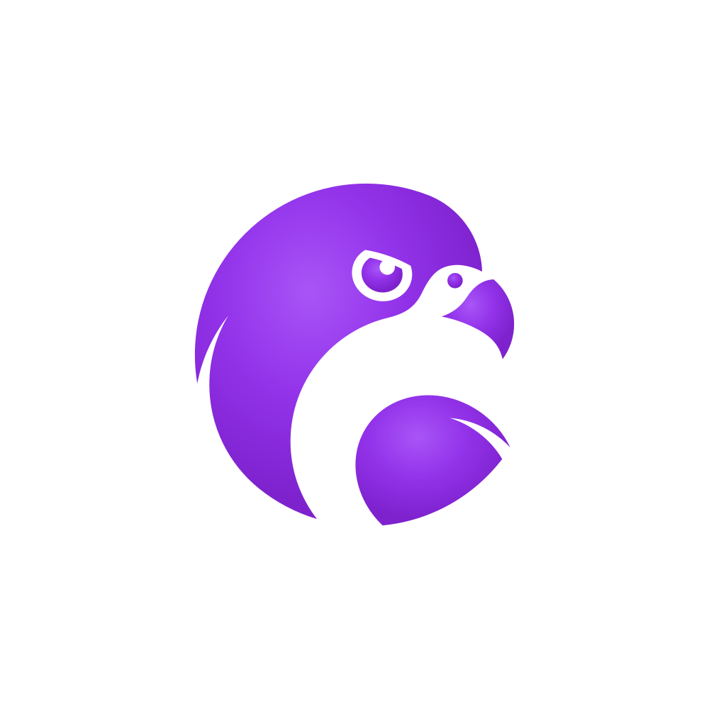
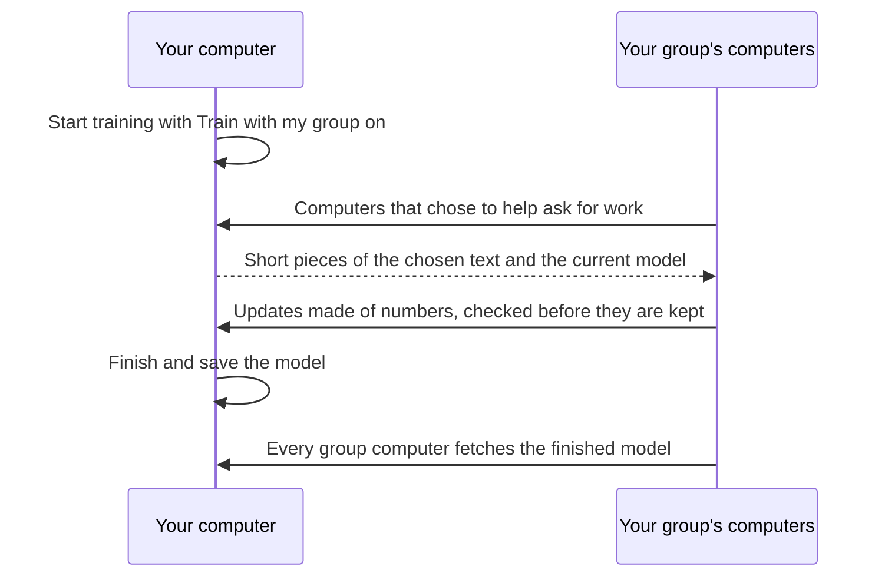
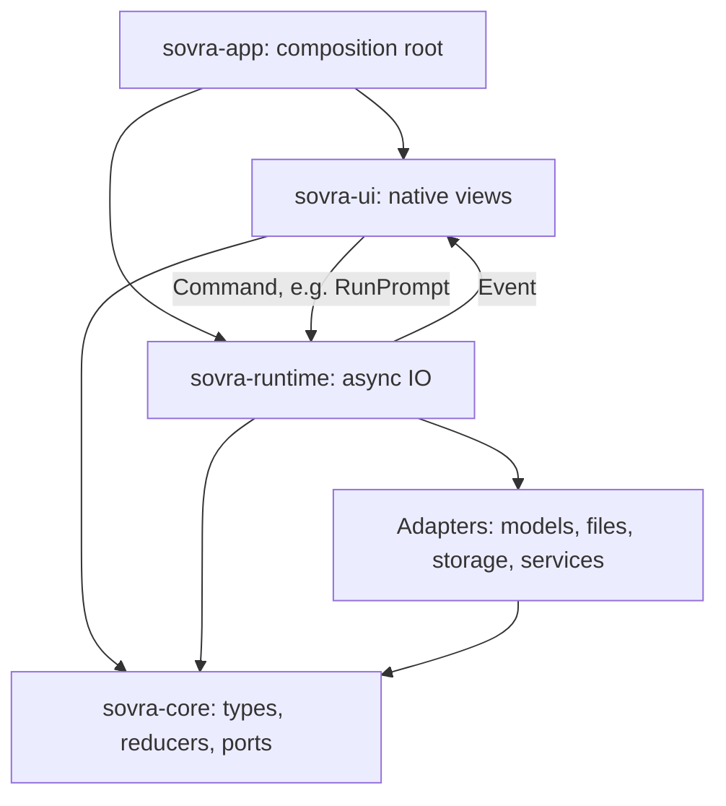

<p align="center">
  
</p>

<h1 align="center">SovraHarness</h1>

<p align="center">
  Your AI workspace, and a place to train your own small AI.<br>
  Privately, across your group's computers, in one app. No cloud. No Python.<br>
  Built in Rust with GPUI for macOS, Windows, and Linux.
</p>

<p align="center">
  <a href="docs/getting-started.md">Getting started</a>
  ·
  <a href="docs/training.md">Train your own AI</a>
  ·
  <a href="docs/README.md">Documentation</a>
  ·
  <a href="https://github.com/Sovra-AI/SovraHarness/releases">Releases</a>
  ·
  <a href="CONTRIBUTING.md">Contributing</a>
  ·
  <a href="CHANGELOG.md">Changelog</a>
</p>

Connect a cloud AI service or a local model server such as Ollama, then use
helpers to work with your knowledge, create documents and websites, and
schedule tasks. Sovra also trains small AI models from your own text: on your
computer, with the computers in your group helping, and with the finished
model delivered to everyone in the group.

Chat choices exclude batch-only models. If an older saved choice ends in
`:batch`, open **Models** and choose a live chat model without that suffix.

Every new chat shows an animated reminder to type `/help` to browse all skills,
even before you connect an AI. That shortcut is drawn as a book icon in a pill.
It stops when you start a draft; reduced-motion settings show the complete
reminder without animation. Pick a skill from the **Skills** page or the chat
shortcut menu to put its name and icon in your draft. Add your request and
press **Send** to use it.

> **License:** Source on `main` is available under Sovra's Sustainable Use License.
> This is fair-code: source-available, and not an OSI open-source license.
> Enterprise files have separate terms. See [License](#license).

## Train your own small AI, privately, with your group

Pick some text, press **Start training**, and watch a model learn to write
like it. The training engine is inside the Sovra executable, so there is
nothing else to install: no cloud account, no Python, no separate trainer and
no model download.



- **Simple to start.** Open **Training** and press
  **Start training**. A sample text, a model size suited to this computer and
  a balanced preset are already chosen.
- **Your group's computers help.** Leave **Train with my group** on. Computers
  in your group that turned on **Help the group train** join in by themselves,
  and a slow or missing one never holds the run up.
- **Everyone gets the model.** When the run finishes, every computer in the
  group receives the same model file, checked on arrival, including computers
  that were switched off at the time.
- **Watch it learn.** A live chart, plain-word numbers, time left, and a sample
  of what the model writes right now.
- **Choose a starting point.** Four built-in sizes, from a table that learns
  in seconds to a small transformer with 2.8 million values. Train any model
  in **Your models** further.
- **Simple presets, full control.** **Quick try**, **Balanced** and
  **Thorough**, with every setting available under **Advanced**.
- **Run it in Ollama, back it up to your bucket.** Turn on **Add finished
  models to Ollama** and each model you finish is ready for `ollama run`.
  Save a storage bucket (S3, R2, B2, Wasabi, MinIO…) and each one is copied
  there with a GGUF version and a short description. Your text file never
  leaves, and each model shows a privacy check of whether it repeats your
  text; a model that does is only sent when you press its button.
- **Keeps the best version.** A run hands back the model as it was at its best
  check, not the one that came after it started to memorise.
- **Uses your graphics card when it helps.** Sovra checks the card itself and
  trains on it when it is clearly faster than the processor, with nothing to
  install or switch on. If the card fails mid-run, the run carries on with
  the processor.
- **See what this computer has.** Processor, cores, memory, the engine in use
  and which model sizes it is comfortable with.
- **Private by default.** Only the text you choose is used, and it leaves this
  computer only when you start a run with your group. Chats, memories and
  files are never added.

What to expect: these are small models that continue text in the style
you taught them. They do not replace the AI that answers chat, pretrained
models cannot be imported, and one graphics card at most is used.
Computers that help can read the pieces of text they work on, so share text
you are willing for your group to read. The [Training guide](docs/training.md)
has the first run, group steps, every setting, privacy details and limits.

## What you can do

- **Train your own small AI:** teach a model from your own text, with your
  group's computers helping, live progress, and the finished model delivered
  to everyone in the group. One app, no cloud, no Python.
- **Chat with helpers:** choose a model, discover capabilities on the Skills
  page, and follow the live work log as helpers work together.
- **Work with your knowledge:** attach files, index local folders, recall saved
  details, and follow each file as Sovra checks it for changes, extracts text, or saves
  passages. Search files, personal details, and saved artifacts together at the top of
  **Knowledge**. Choose **Open knowledge map** to explore folders, findings, personal
  records, saved work, people and group knowledge together. Scroll over the full-workspace map to zoom. Hover over a point to highlight its neighbours. **Found in your files** shows what Sovra classified automatically.
  Expand **Relationships & categories** to see what your files are, read each
  connection as a short sentence, and open the line it came from. Helpers in
  chat can use the same findings: ask **See what's in your folders** about the
  measurements, dates and tables in your files.
- **Save your work:** organize versioned documents, code, and other artifacts
  into folders and favorites. Preview saved websites in your browser.
- **Keep company decisions:** record reasons, quoted evidence, review dates and
  company-written hard stops in **Artifacts → Decisions**, or start from a chat
  reply with **Record a decision**. A second person signs in with a different
  local account to accept the saved version. A guest visit does not count.
  Edits keep earlier versions and
  require fresh acceptance. See
  [Decision records](docs/decisions.md) for the local-account approval boundary.
- **Connect services:** use Google, GitHub, WhatsApp, Telegram, and MCP tools.
- **Link online storage:** add Amazon S3, Cloudflare R2, Backblaze B2, Wasabi, Google Cloud
  Storage, MinIO and other S3-compatible buckets, Azure Blob containers, or Nextcloud,
  ownCloud and other WebDAV file servers. Sovra browses, reads and (when you allow it) saves
  files there. See [Online storage](docs/online-storage.md).
  Connection setup and permissions depend on the service.
- **Official plugins in one click:** **Plugins → Made by Sovra** lists the plugins the
  Sovra team publishes, with what each one does. **Install** adds it and turns it on;
  **What you can do next** then offers its first steps as buttons. The first is **Computer pool**
  ([Sovra-AI/sovra-compute-pool](https://github.com/Sovra-AI/sovra-compute-pool)):
  join your Linux computers into one pool and run big jobs, such as AI training, on
  their processors and graphics cards.
- **Download plugins:** open **Plugins** (in the menu on the left) and paste a GitHub repository
  address to add its `SKILL.md` skills and tools, or browse a GitHub Pages catalog. A plugin's
  tools run their own code in a sealed box that sees nothing on your computer and reaches only
  the internet addresses it lists, and only after you choose **Allow and turn on**. This
  repository is one: add `Sovra-AI/SovraHarness` for exact date sums. Turn
  plugins on or off and review updates. Choose **Remove** to read or copy a
  cleanup guide, review connections, or get help undoing setup on other computers
  before confirming removal. To make your own, start from the open-source
  [plugin template](https://github.com/Sovra-AI/sovra-plugin-template). See [Plugins](docs/plugins.md) for
  the package contract, editor schema, read-only catalog check, and publisher.
- **Schedule tasks:** run repeating prompts, confirm timed messages, or send a
  scheduled search note to a WhatsApp group.
- **Share with a group:** share selected knowledge, artifacts, helpers, and
  schedules across computers, with a signed history of sharing activity. The
  computers can be on different networks or in different countries: an invite
  link works from anywhere for seven days, and the Groups page shows who is
  online and how each computer is connected. A computer can be in several
  groups, and any chat message can be shared with a group in one press.

The interface includes a guided tour, a language picker, Arabic right-to-left
layout, and adjustable text size. See the [getting started guide](docs/getting-started.md)
for a tour of the features.

## Quick start

### Install a release

Open [GitHub Releases](https://github.com/Sovra-AI/SovraHarness/releases), choose
an asset for your operating system and architecture, and follow the release's
installation notes. Signing depends on the credentials available for that build;
check its release notes. In-app update checks are not implemented. See the
[roadmap](docs/roadmap.md).

After launching:

1. Create or open a local account, or choose **Continue as guest**.
2. Follow the guided tour or open **Models** to connect a service and choose a
   chat model. Cloud services may require a key and charge for usage. For Ollama,
   install Ollama once; Sovra starts its local server when you use it.
   Sixteen other local-server presets, including LM Studio, llama.cpp, LocalAI,
   Jan and GPT4All, share compatible chat support. Start those servers in their
   own programs. See [local model setup](docs/local-models.md) for the full list,
   official references, startup behavior and troubleshooting.
3. Send a message in **Chat**, or open **Skills** to try an example.

To try training, open **Training** and press **Start training**. It needs no
chat provider or API key. To train with other computers, follow the
[group training steps](docs/training.md#train-with-your-group).

For connection problems, see [Models](docs/models.md) and
[Configuration and local data](docs/configuration.md).

### Build from source

Install Git and Rust through rustup. The repository pins Rust **1.99.1** in
[rust-toolchain.toml](rust-toolchain.toml). You also need your platform's build tools:

| Platform | Prerequisites |
| --- | --- |
| macOS | Xcode command-line tools |
| Windows | Visual Studio C++ build tools, Windows SDK, and the MSVC Rust target |
| Linux | System packages installed by `./scripts/install-linux-deps.sh` |

```sh
git clone https://github.com/Sovra-AI/SovraHarness.git
cd SovraHarness
# Linux only: ./scripts/install-linux-deps.sh
cargo xtask setup
cargo xtask dev
```

`cargo xtask dev` builds and launches once with `SOVRA_DEV=1`. Close the running
session and run it again after edits; there is no file watcher or hot reload.
Development mode enables local authenticated app control and stores development
keys in separate plaintext files outside the checkout (owner-only on Unix).
Ordinary launches and release builds start development control off; release keys
use the OS keychain. See [Native development](docs/development.md).

The native app does not require Node.js or Python. Building generated frontend
projects requires Node.js/npm and approved terminal access. Packaging has
additional prerequisites in the [release guide](docs/releasing.md).

## Status and data boundaries

Sovra is under active development. Read the [changelog](CHANGELOG.md) for changes,
the [documentation](docs/README.md) for current behavior, and the
[roadmap](docs/roadmap.md) for the only list of work that is still open.

- Local storage does not make every operation offline. Cloud models and connected
  tools receive the content needed for their requests; group networking can use
  discovery and encrypted relays. Review the [network inventory](docs/network.md).
- Local accounts do not provide separate encrypted data stores. Terminal commands
  and local MCP programs run with your OS permissions, without a sandbox.
- **My AIs** shows your saved chat AI, with **Chat** and **Change AI**, how long it
  thinks (from **No thinking** to **Think deeply**, also set from the chat box), and an optional different AI and
  thinking level for simple, medium and complex questions. Messages are sorted by
  built-in quick rules or by Laya, a small sorting AI compiled into the executable
  whose files are downloaded once; no routing service is used. See
  [Models](docs/models.md#choose-an-ai-by-how-hard-the-question-is).
- Website hosting supports static output; server backends and server-side
  rendering are not hosted. Hosting stops when Sovra closes.
- Phone control pairs with the [SovraiOS](https://github.com/Sovra-AI/SovraiOS) and
  [SovraAndroid](https://github.com/Sovra-AI/SovraAndroid) apps, built from source;
  no store release is published. Groups support borrowing another computer's AI for chat; embedding and indexing work are not handed off.
- Training teaches small built-in models from text you choose; it does not
  import or fine-tune pretrained models. A run started with your group sends
  pieces of that text to group computers that help. See
  [Training: privacy and consent](docs/training.md#privacy-and-consent).

See [Security](SECURITY.md) for credential storage and execution boundaries.

## Development

| Command | Purpose |
| --- | --- |
| `cargo xtask dev` | One-shot development build and launch |
| `cargo xtask run` | Debug launch without `SOVRA_DEV` |
| `cargo xtask ci` | All required formatting, lint, architecture, docs, dependency, and test gates |
| `cargo xtask fix` | Apply formatting and Clippy fixes |
| `cargo xtask check-docs` | Check documentation links and required diagrams |
| `cargo xtask dist` | Build and verify a native installer |

See [CONTRIBUTING.md](CONTRIBUTING.md) for the pull request workflow and
[AGENTS.md](AGENTS.md) for engineering rules. To test the running app through an
MCP client, follow [Development MCP](docs/development-mcp.md).

This repository is also a plugin with skills for working on Sovra: adding a
feature, changing a screen, fixing a bug, finishing a change, and making your own
plugin. In Sovra, paste `Sovra-AI/SovraHarness` into **Plugins → Add from GitHub**.
In Claude Code, run:

```text
/plugin install sovra-harness --marketplace Sovra-AI/SovraHarness
```

The skills live in [`skills/`](skills); see
[This repository as a plugin](docs/plugins.md#this-repository-as-a-plugin).

### Architecture

Domain decisions live in `sovra-core`, IO lives in adapters, and views live in
`sovra-ui`. The UI sends commands and receives events through
`sovra_runtime::Client`.



The enforced dependency rules live in [xtask/src/deps.rs](xtask/src/deps.rs).
Read [Architecture](docs/architecture.md) and
[Memory capture and recall](docs/memory-capture-and-recall.md) for the full design.

## Documentation

**Connections → Connect Microsoft 365** guides you through connecting your own
Microsoft registration in four steps: choose your account, register it with
Microsoft, save the desktop return address, and paste the public IDs. The guide
includes copy buttons, ID checks and a help request for your administrator.
No shared Sovra Microsoft account, client secret, configuration file or custom
binary is needed. Microsoft Entra registration access is required, even for
personal Outlook accounts. Outlook, OneDrive, contacts, To Do and OneNote are
included; Teams, SharePoint and Planner are optional service choices. Word,
Excel and PowerPoint use the existing document readers. The
[Microsoft 365 guide](docs/microsoft-365.md) covers setup, troubleshooting,
permissions and service limits.

| Guide | Covers |
| --- | --- |
| [Training](docs/training.md) | Train your own small AI: first run, group training and delivery, live numbers, settings, privacy, and limits |
| [Getting started](docs/getting-started.md) | First launch, first chat, and finding features |
| [Configuration](docs/configuration.md) | Startup variables, data paths, and troubleshooting |
| [Models](docs/models.md) | Providers, keys, and choosing your chat AI |
| [Files](docs/files.md) and [Knowledge](docs/knowledge.md) | Attachments, saved details, sources, and a saved answer that keeps the wording read from a file |
| [Teams and artifacts](docs/teams-and-artifacts.md) | Helpers and saved work |
| [Schedules](docs/schedules.md) and [Groups](docs/groups.md) | Recurring work and sharing |
| [Connections](docs/connected-services.md) | MCP tools and service setup |
| [Online storage](docs/online-storage.md) | Buckets and file servers: services, setup, what Sovra may do, privacy and limits |
| [Documentation index](docs/README.md) | All guides and technical references |

## Contributing and support

Bug reports, feature requests, documentation improvements, and code contributions
are welcome. Search [existing issues](https://github.com/Sovra-AI/SovraHarness/issues)
before opening a new one, and follow [CONTRIBUTING.md](CONTRIBUTING.md) when
submitting a pull request. Include your app version, OS, and reproduction steps;
remove credentials and personal data from logs and screenshots.

Follow the [Code of Conduct](CODE_OF_CONDUCT.md) in project spaces. Report
vulnerabilities using [SECURITY.md](SECURITY.md), without posting exploit details
in public issues.

## Shipping

[cargo xtask dist](docs/releasing.md) builds installers under `target/dist/`.
The release workflow publishes executables and the Velopack feed when a push to
`main` bumps the package version; a matching `vX.Y.Z` tag can run the same workflow.
See the [release guide](docs/releasing.md) for versioning, signing, and verification.

## License

[LICENSE](LICENSE) is Sovra's Sustainable Use License, Version 1.0, with Sovra
as the licensor. This is a fair-code license with use and distribution
restrictions, not an OSI open-source license. It applies to source on `main`;
the license excludes other branches. Files with `.ee.` in their name or `.ee` in their directory name
are covered separately by [LICENSE_EE.md](LICENSE_EE.md). Third-party components
retain their own licenses.
