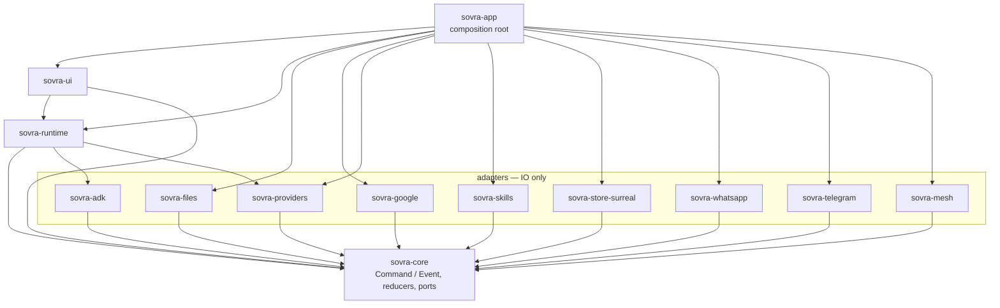
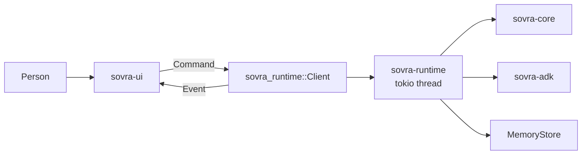
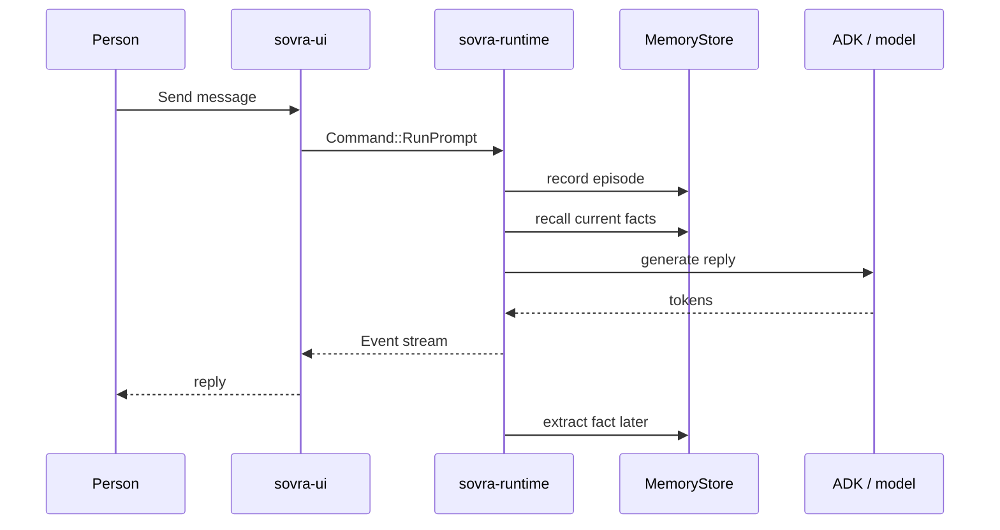

# SovraHarness

> **Closed source — proprietary to Sovra.** Copyright © 2026 Sovra. All rights
> reserved. Do not copy, distribute, or disclose outside Sovra. See [LICENSE](LICENSE).

Native Rust desktop app for the Sovra agent harness: a GPUI chat UI, a tokio
runtime, local memory (vector + graph + full-text behind a `MemoryStore` port),
and Velopack installers. Chrome defaults to Arabic, with a Settings language
picker and right-to-left layout. Settings → Groups lets a family or small team
share selected knowledge across their computers. Helper bundles and work handoff
remain planned; see [Groups](docs/groups.md). macOS, Windows and Linux from
one codebase.

The Knowledge page includes an interactive map of saved details and their
connections. Select a label to read its story, filter the kinds of connections,
or choose **Read as a list**. **Focus on these connections** opens a smaller
map around the selected detail; **Show all** restores the overview. The map
renders natively inside the app, with no extra runtime or browser dependency.

## Quick start

```sh
just dev
```

Or without `just`:

```sh
cargo xtask setup
cargo xtask dev
```

On Linux, install system packages once with `./scripts/install-linux-deps.sh`.
The native app does not require Node or Python. Install Rust and the platform
build tools first; packaging additionally requires .NET and Velopack. See
[development](docs/development.md) and [releasing](docs/releasing.md).

`cargo xtask dev` is a **one-shot** debug launch with `SOVRA_DEV=1`. There is no
file watcher and no save-triggered reload — run it again after you edit. Details:
[native development](docs/development.md). To drive the running window from Codex
or Claude Code, see [Development MCP](docs/development-mcp.md).

## Commands

| Command                    | What it does                                                                 |
| -------------------------- | ---------------------------------------------------------------------------- |
| `cargo xtask dev`          | One-shot debug build + launch (`SOVRA_DEV=1`); re-run to reload              |
| `cargo xtask run`          | Launch the app (debug, without `SOVRA_DEV`)                                  |
| `cargo xtask ci`           | Every gate: fmt, clippy, layering, styles, docs, cargo-deny, unused deps, tests |
| `cargo xtask fix`          | Auto-apply fmt + clippy fixes                                                |
| `cargo xtask check-styles` | Native styling boundary and the bundled SVG logo                             |
| `cargo xtask check-docs`   | README mermaid graphs and relative markdown links                            |
| `cargo xtask setup`        | Install pinned CI tools (deny, nextest, shear)                               |
| `cargo xtask dist`         | Release build and verified native installer (Velopack `vpk` 1.2.161)         |
| `just clear-cache`         | Reclaim Cargo build caches when no `dev` session is running                  |

## How it is put together

Dependencies point inward toward `sovra-core`. The table in
`xtask/src/deps.rs` is the architecture; `cargo xtask check-deps` enforces it.
Why those splits: [architecture](docs/architecture.md).



## How the UI talks to the runtime

The UI never sees tokio. It sends a `Command` and receives an `Event` on
`sovra_runtime::Client`. Headless UI tests use `Client::loopback()`.



## How one chat turn is remembered

A private chat message is saved as raw evidence immediately. The reply uses
facts already in the store. Extracting a new fact runs in the background and
can only appear on a later turn. Full path:
[memory capture and recall](docs/memory-capture-and-recall.md).



## Docs

| Guide | What it covers |
| ----- | -------------- |
| [Getting started](docs/getting-started.md) | First launch, first chat and finding features |
| [Configuration and local data](docs/configuration.md) | Startup variables, data paths and troubleshooting |
| [Schedules](docs/schedules.md) | Repeating prompts and confirmed timed messages |
| [Groups](docs/groups.md) | People, computers and explicitly shared knowledge |
| [Release guide](docs/releasing.md) | Packaging, signing and release verification |
| [Roadmap](docs/roadmap/README.md) | Implemented foundations and planned stages |
| [Architecture](docs/architecture.md) | Crate layering, Command/Event, why each dependency |
| [Native development](docs/development.md) | One-shot `cargo xtask dev`, cache, sign-in status |
| [Development MCP](docs/development-mcp.md) | Drive the running app from Codex or Claude Code |
| [Reviewing knowledge](docs/knowledge.md) | Check sources, explore connections and stop recall |
| [Memory capture and recall](docs/memory-capture-and-recall.md) | One chat turn through save and later recall |
| [Agent memory log](docs/agent-memory.md) | Dated audits and measured limits |
| [Models](docs/models.md) | Connect a service, pick a chat model |
| [Files in chat](docs/files.md) | Paperclip attachments and the document reader |
| [File understanding](docs/file-ontology.md) | What a file is, live folder reading |
| [Skills and file knowledge](docs/skills-and-file-knowledge.md) | Skills page, folder index, dated implementation log |
| [MCP servers](docs/connected-services.md) | Extra tools from a URL, a local program, or paste |
| [Messaging](docs/communications.md) | WhatsApp, Telegram, sending from desktop chat |
| [Google](docs/google.md) | Connect Google, per-service switches |
| [Terminal](docs/terminal.md) | Allow-once commands on this computer |
| [Teams and artifacts](docs/teams-and-artifacts.md) | Helpers in chat, saveable work |
| [Styling](docs/styling.md) | Native design system and responsive layout |
| [Docs index](docs/README.md) | The same map, living next to the files |

## Shipping

`cargo xtask dist` builds a native installer under `target/dist/` (Velopack
`vpk` 1.2.161). Push a `vX.Y.Z` tag; [`.github/workflows/release.yml`](.github/workflows/release.yml)
packages each OS. In-app update checking is not wired yet. More:
[architecture → distribution](docs/architecture.md#distribution-velopack).

## Contributing

Day-to-day work goes through pull requests against `main`. Workflow:
[CONTRIBUTING.md](CONTRIBUTING.md). Canonical rules: [AGENTS.md](AGENTS.md).
Security: [SECURITY.md](SECURITY.md). Changelog: [CHANGELOG.md](CHANGELOG.md).
