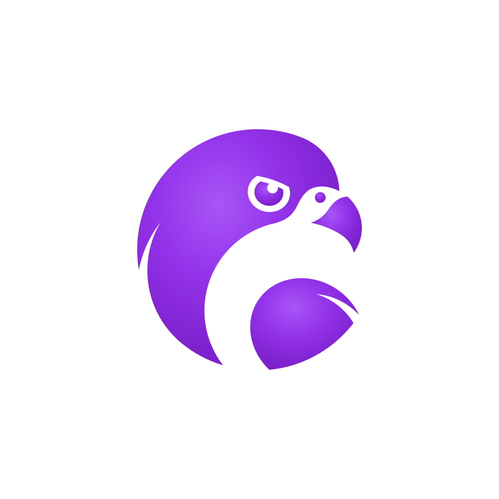
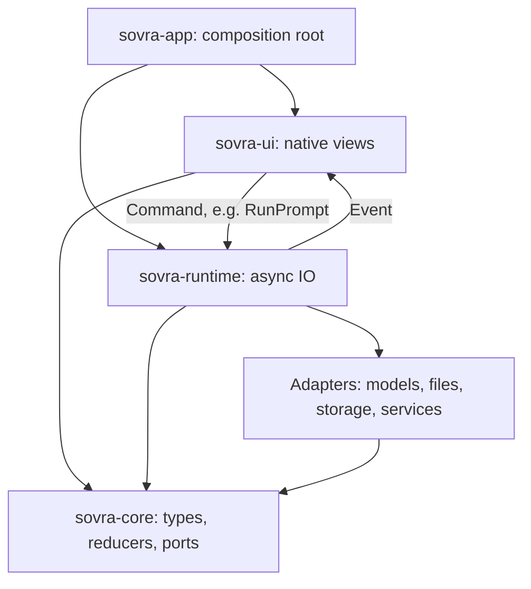

<p align="center">
  
</p>

<h1 align="center">SovraHarness</h1>

<p align="center">
  A native desktop workspace for AI chat, local memory, files, and shared work.<br>
  Built in Rust with GPUI for macOS, Windows, and Linux.
</p>

<p align="center">
  <a href="docs/getting-started.md">Getting started</a>
  ·
  <a href="docs/README.md">Documentation</a>
  ·
  <a href="https://github.com/Sovra-AI/SovraHarness/releases">Releases</a>
  ·
  <a href="CONTRIBUTING.md">Contributing</a>
  ·
  <a href="CHANGELOG.md">Changelog</a>
</p>

Connect a cloud AI service or a local model server such as Ollama, then use
helpers to work with your knowledge, create documents and websites, and
schedule tasks.

> **License:** Source on `main` is available under Sovra's Sustainable Use License.
> This is fair-code: source-available, and not an OSI open-source license.
> Enterprise files have separate terms. See [License](#license).

## What you can do

- **Chat with helpers:** choose a model, discover capabilities on the Skills
  page, and follow the live work log as helpers work together.
- **Work with your knowledge:** attach files, index local folders, recall saved
  details, and explore their sources and connections.
- **Save your work:** organize versioned documents, code, and other artifacts
  into folders and favorites. Preview saved websites in your browser.
- **Connect services:** use Google, GitHub, WhatsApp, Telegram, and MCP tools.
  Connection setup and permissions depend on the service.
- **Schedule tasks:** run repeating prompts, confirm timed messages, or send a
  scheduled search note to a WhatsApp group.
- **Share with a group:** share selected knowledge, artifacts, helpers, and
  schedules across computers, with a signed history of sharing activity.

The interface includes a guided tour, a language picker, Arabic right-to-left
layout, and adjustable text size. See the [getting started guide](docs/getting-started.md)
for a tour of the features.

## Quick start

### Install a release

Open [GitHub Releases](https://github.com/Sovra-AI/SovraHarness/releases), choose
an asset for your operating system and architecture, and follow the release's
installation notes. Signing depends on the credentials available for that build;
check its release notes. In-app update checks are not implemented yet.

After launching:

1. Create or open a local account.
2. Follow the guided tour or open **Models** to connect a service and choose a
   chat model. Cloud services may require a key and charge for usage. For Ollama,
   install and start the local model server separately.
3. Send a message in **Chat**, or open **Skills** to try an example.

For connection problems, see [Models](docs/models.md) and
[Configuration and local data](docs/configuration.md).

### Build from source

Install Git and Rust through rustup. The repository pins Rust **1.99.1** in
[rust-toolchain.toml](rust-toolchain.toml). You also need your platform's build tools:

| Platform | Prerequisites |
| --- | --- |
| macOS | Xcode command-line tools |
| Windows | Visual Studio C++ build tools, Windows SDK, and the MSVC Rust target |
| Linux | System packages installed by `./scripts/install-linux-deps.sh` |

```sh
git clone https://github.com/Sovra-AI/SovraHarness.git
cd SovraHarness
# Linux only: ./scripts/install-linux-deps.sh
cargo xtask setup
cargo xtask dev
```

`cargo xtask dev` builds and launches once with `SOVRA_DEV=1`. Close the running
session and run it again after edits; there is no file watcher or hot reload.
Development mode enables local authenticated app control and stores development
keys in separate plaintext files outside the checkout (owner-only on Unix).
Ordinary launches and release builds start development control off; release keys
use the OS keychain. See [Native development](docs/development.md).

The native app does not require Node.js or Python. Building generated frontend
projects requires Node.js/npm and approved terminal access. Packaging has
additional prerequisites in the [release guide](docs/releasing.md).

## Status and data boundaries

Sovra is under active development. Read the [changelog](CHANGELOG.md) for changes
and the [documentation](docs/README.md) for current behavior.

- Local storage does not make every operation offline. Cloud models and connected
  tools receive the content needed for their requests; group networking can use
  discovery and encrypted relays. Review the [network inventory](docs/network.md).
- Local accounts do not provide separate encrypted data stores. Terminal commands
  and local MCP programs run with your OS permissions, without a sandbox.
- **My AIs** offers routing previews; these do not change the model answering chat
  or verify connection availability. Preview settings last for the session.
- Website hosting supports static output; server backends and server-side
  rendering are not hosted. Hosting stops when Sovra closes.
- Phone control has a desktop connection and reference client; the mobile app
  is not built yet. Groups support borrowing another computer's AI for chat; embedding and indexing work are not handed off.

See [Security](SECURITY.md) for credential storage and execution boundaries.

## Development

| Command | Purpose |
| --- | --- |
| `cargo xtask dev` | One-shot development build and launch |
| `cargo xtask run` | Debug launch without `SOVRA_DEV` |
| `cargo xtask ci` | All required formatting, lint, architecture, docs, dependency, and test gates |
| `cargo xtask fix` | Apply formatting and Clippy fixes |
| `cargo xtask check-docs` | Check documentation links and required diagrams |
| `cargo xtask dist` | Build and verify a native installer |

See [CONTRIBUTING.md](CONTRIBUTING.md) for the pull request workflow and
[AGENTS.md](AGENTS.md) for engineering rules. To test the running app through an
MCP client, follow [Development MCP](docs/development-mcp.md).

### Architecture

Domain decisions live in `sovra-core`, IO lives in adapters, and views live in
`sovra-ui`. The UI sends commands and receives events through
`sovra_runtime::Client`.



The enforced dependency rules live in [xtask/src/deps.rs](xtask/src/deps.rs).
Read [Architecture](docs/architecture.md) and
[Memory capture and recall](docs/memory-capture-and-recall.md) for the full design.

## Documentation

| Guide | Covers |
| --- | --- |
| [Getting started](docs/getting-started.md) | First launch, first chat, and finding features |
| [Configuration](docs/configuration.md) | Startup variables, data paths, and troubleshooting |
| [Models](docs/models.md) | Providers, keys, model selection, and routing previews |
| [Files](docs/files.md) and [Knowledge](docs/knowledge.md) | Attachments, saved details, and sources |
| [Teams and artifacts](docs/teams-and-artifacts.md) | Helpers and saved work |
| [Schedules](docs/schedules.md) and [Groups](docs/groups.md) | Recurring work and sharing |
| [Connections](docs/connected-services.md) | MCP tools and service setup |
| [Documentation index](docs/README.md) | All guides and technical references |

## Contributing and support

Bug reports, feature requests, documentation improvements, and code contributions
are welcome. Search [existing issues](https://github.com/Sovra-AI/SovraHarness/issues)
before opening a new one, and follow [CONTRIBUTING.md](CONTRIBUTING.md) when
submitting a pull request. Include your app version, OS, and reproduction steps;
remove credentials and personal data from logs and screenshots.

Follow the [Code of Conduct](CODE_OF_CONDUCT.md) in project spaces. Report
vulnerabilities using [SECURITY.md](SECURITY.md), without posting exploit details
in public issues.

## Shipping

[cargo xtask dist](docs/releasing.md) builds installers under `target/dist/`.
The release workflow publishes executables and the Velopack feed when a push to
`main` bumps the package version; a matching `vX.Y.Z` tag can run the same workflow.
See the [release guide](docs/releasing.md) for versioning, signing, and verification.

## License

[LICENSE](LICENSE) is Sovra's Sustainable Use License, Version 1.0, with Sovra
as the licensor. This is a fair-code license with use and distribution
restrictions, not an OSI open-source license. It applies to source on `main`;
the license excludes other branches. Files with `.ee.` in their name or `.ee` in their directory name
are covered separately by [LICENSE_EE.md](LICENSE_EE.md). Third-party components
retain their own licenses.
