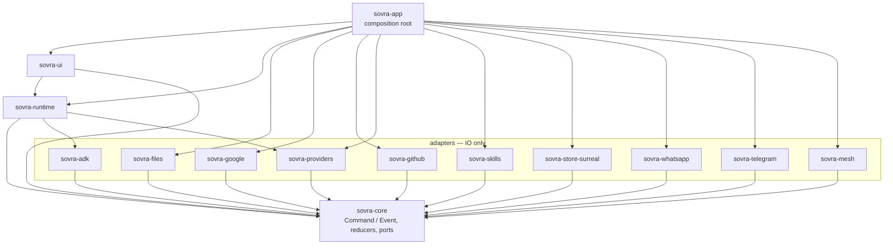
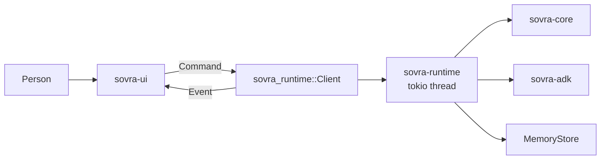
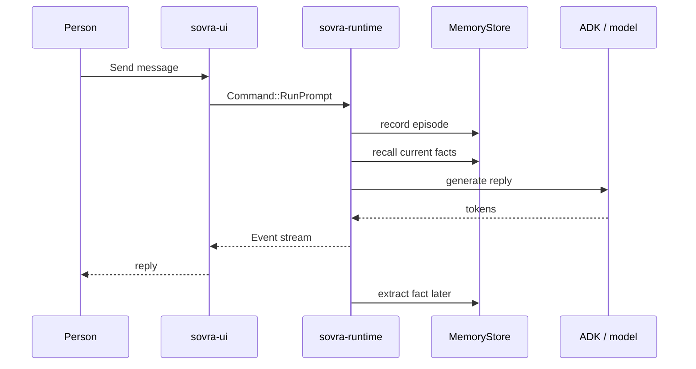

# SovraHarness

> **Closed source — proprietary to Sovra.** Copyright © 2026 Sovra. All rights
> reserved. Do not copy, distribute, or disclose outside Sovra. See [LICENSE](LICENSE).

Native Rust desktop app for the Sovra agent harness: a GPUI chat UI, a tokio
runtime, local memory (vector + graph + full-text behind a `MemoryStore` port),
and Velopack installers. Chrome defaults to English, with a language picker (on the
sign-in screen and in Settings) and right-to-left layout for Arabic. The **Groups** tab lets a family or small team
share memories, documents, lists, helpers and schedules across their computers:
**Share with my group** (or *Just Dad*) on an artifact, a saved detail, a helper or
a schedule, **Keep a copy** of what others shared, and edits come back as new
versions. **Ask my group** asks the memories of computers whose owners allow it,
without copying those memories. **History on this computer** shows a signed,
tamper-evident record of everything shared and every memory given out. Work
handoff remains planned; see
[Groups](docs/groups.md). macOS, Windows and Linux from one codebase.

The Knowledge page includes an interactive map of saved details and their
connections. Select a label to read its story, filter the kinds of connections,
or choose **Read as a list**. **Focus on these connections** opens a smaller
map around the selected detail; **Show all** restores the overview. The map
renders natively inside the app, with no extra runtime or browser dependency.

AI setup guides you through adding a service's connection key and choosing an
AI. OpenRouter offers free and paid choices. A saved key means Sovra has stored
it; use **Check key** to check whether the service accepts it.
If a key is already supplied by this computer's settings, continue straight to
**Next: pick a chat model**. You do not need to create or save another key.

The **Groups** tab explains itself in plain words: *What is a group?*, what you
can do in one, and how it works. You choose **Start a new group** or **Join a
group** and answer two or three labelled questions. Inside a group, one page at a
time (**Invite someone**, **Shared notes**, **People**, **Shared helpers**,
**Ask the group**, and under **More…** **Borrow an AI**, **Smaller circles**, **History**) says what it is
for and how to use it in numbered steps, and a **Getting started** list shows what
a new group still has to do. Under **Invite someone**, **Create invite link** makes
a one-time link and copies it for you to send. Leaving removes you and all your
computers. If you are alone, it ends the group; if others remain, another admin
must be available. History confirmations wait for
the matching records to arrive and continue as computers catch up.
Sharing a note keeps your draft until you choose **Write another note**.
**Sharing…** changes to a confirmation after the note is saved; failed shares
keep your words for retry. Artifact sharing, **Keep a copy**, and **Stop sharing**
also wait for confirmation and allow retry when a request fails.

While Sovra works, each reply shows a live work log above the answer: every
step in plain words ("Searching the web for …"), helpers working side by side in
their own lanes, and how long each step took. Afterwards it folds into one line
you can reopen. Team turns show a **Waiting / Working / Done** board, and members
picked for a round answer at the same time. Every helper runs under bounded step,
failure and repeat limits; see [The agent loop](docs/agent-loop.md).

Ask Sovra to build a website, then ask it to run the saved website. The code
panel shows source while it is written; **Run website** opens saved HTML in your
browser at a local address. **Stop website** ends hosting without deleting the
artifact. **Open in browser** uses a local HTTP address, including for diagrams
and pictures. React, Vue, Svelte and other frontend projects are saved as one
multi-file artifact: inspect individual files, then choose **Build and open**.
Install Node.js/npm and enable terminal access first; review build commands in
chat. Projects must produce static files (usually `dist`); server backends and
server-side rendering are not hosted. Hosting ends when Sovra closes.

Organize Artifacts into named folders, mark favorites, search by name or content,
and sort by recent changes, name or oldest first. Results appear 24 per page.
Older work appears under **Unfiled** until you move it.
If no results match, **Show all saved work** clears the search, folder, type and
Favorites filters together without changing anything you saved.
When editing saved work, Back and Cancel ask before discarding changes. Choose
**Keep editing** to return to your draft or **Discard changes** to leave it.
Saving keeps the editor open until confirmed. If it fails, your changes remain
in the form so you can retry; typing during a save keeps the newer draft open.

Type `/remote-control` in chat to open **Use Sovra from your phone**, enable
phone access and show a one-use pairing QR. Paired phones are remembered, but
access starts off after every restart. **Stop phone control** ends access and
**Forget** revokes a phone. The mobile app is not built yet; the desktop
connection, runnable reference client and [mobile integration contract](docs/remote-control.md)
are ready for integration testing with that future app.

## Quick start

Scheduled tasks keep their previous saved state when an update cannot be saved.
The creation form preserves entries on failure and waits for confirmation before closing.
Runs start only after their run record is saved; see [Schedules](docs/schedules.md).

Open **Skills**, directly below **Chat** in the expanded sidebar, to discover
what Sovra can do and try an example. The account footer's **Sign out** action
returns to the sign-in screen.
If you created your account with only a name, choose the sign-in button with your name
to reopen it on this computer. Email/password and Google accounts use their
usual sign-in methods.
Sign-in fields keep their labels visible while you type; translated page headings
and sign-in instructions support right-to-left paragraph wrapping.
Skills' **Open now** buttons open the relevant feature directly; **Try in chat**
and **Try the example** prepare a draft for you to review before sending.
When adding your own skill, use a name in your language and leave **Shortcut**
blank. Sovra chooses an unused shortcut automatically, including for Arabic
names. To change an existing skill, open its **Edit** action.
Ask in chat to send a WhatsApp to a person or to one of your WhatsApp groups by
name. Sovra shows the message for you to press **Send**; afterwards you can choose
**Yes, don't ask again** for that chat, and undo it any time from the message or
Settings → WhatsApp → **Sends without asking**.

```sh
just dev
```

Or without `just`:

```sh
cargo xtask setup
cargo xtask dev
```

On Linux, install system packages once with `./scripts/install-linux-deps.sh`.
The native app does not require Node or Python. Install Rust and the platform
build tools first; packaging additionally requires .NET and Velopack. See
[development](docs/development.md) and [releasing](docs/releasing.md).

`cargo xtask dev` is a **one-shot** debug launch with `SOVRA_DEV=1`. There is no
file watcher and no save-triggered reload — run it again after you edit. Details:
[native development](docs/development.md). To drive the running window from Codex
or Claude Code, see [Development MCP](docs/development-mcp.md).

## Commands

| Command                    | What it does                                                                 |
| -------------------------- | ---------------------------------------------------------------------------- |
| `cargo xtask dev`          | One-shot debug build + launch (`SOVRA_DEV=1`); re-run to reload              |
| `cargo xtask run`          | Launch the app (debug, without `SOVRA_DEV`)                                  |
| `cargo xtask ci`           | Every gate: fmt, clippy, layering, styles, docs, cargo-deny, unused deps, tests |
| `cargo xtask fix`          | Auto-apply fmt + clippy fixes                                                |
| `cargo xtask check-styles` | Native styling boundary and the bundled SVG logo                             |
| `cargo xtask check-docs`   | README mermaid graphs and relative markdown links                            |
| `cargo xtask setup`        | Install pinned CI tools (deny, nextest, shear)                               |
| `cargo xtask dist`         | Release build and verified native installer (Velopack `vpk` 1.2.161)         |
| `just free-cache`          | Reclaim Cargo build caches when no `dev` session is running (`clear-cache` also works) |

## How it is put together

Dependencies point inward toward `sovra-core`. The table in
`xtask/src/deps.rs` is the architecture; `cargo xtask check-deps` enforces it.
Why those splits: [architecture](docs/architecture.md).



## How the UI talks to the runtime

The UI never sees tokio. It sends a `Command` and receives an `Event` on
`sovra_runtime::Client`. Headless UI tests use `Client::loopback()`.



## How one chat turn is remembered

A private chat message is saved as raw evidence immediately. The reply uses
facts already in the store. Extracting a new fact runs in the background and
can only appear on a later turn. Full path:
[memory capture and recall](docs/memory-capture-and-recall.md).
Background checks that find no new facts leave ongoing lookups intact. Corrections,
removals and new fact writes still invalidate older results so replies do not use
outdated details.



## Docs

| Guide | What it covers |
| ----- | -------------- |
| [Getting started](docs/getting-started.md) | First launch, first chat and finding features |
| [Configuration and local data](docs/configuration.md) | Startup variables, data paths and troubleshooting |
| [Schedules](docs/schedules.md) | Repeating prompts and confirmed timed messages |
| [Groups](docs/groups.md) | People, computers and explicitly shared knowledge |
| [Release guide](docs/releasing.md) | Packaging, signing and release verification |
| [Roadmap](docs/roadmap/README.md) | Implemented foundations and planned stages |
| [Architecture](docs/architecture.md) | Crate layering, Command/Event, why each dependency |
| [Native development](docs/development.md) | One-shot `cargo xtask dev`, cache, sign-in status |
| [Development MCP](docs/development-mcp.md) | Drive the running app from Codex or Claude Code |
| [Phone remote control](docs/remote-control.md) | Desktop pairing and control, research and future mobile integration |
| [Reviewing knowledge](docs/knowledge.md) | Check sources, explore connections and stop recall |
| [Memory capture and recall](docs/memory-capture-and-recall.md) | One chat turn through save and later recall |
| [Agent memory log](docs/agent-memory.md) | Dated audits and measured limits |
| [Knowledge benchmark](docs/knowledge-benchmark.md) | Tool assessment and reproducible source-retrieval diagnostic |
| [Models](docs/models.md) | Connect a service, pick a chat model |
| [Files in chat](docs/files.md) | Paperclip attachments and the document reader |
| [File understanding](docs/file-ontology.md) | What a file is, live folder reading |
| [Skills and file knowledge](docs/skills-and-file-knowledge.md) | Skills page, folder index, dated implementation log |
| [MCP servers](docs/connected-services.md) | Extra tools from a URL, a local program, or paste |
| [Messaging](docs/communications.md) | WhatsApp, Telegram, sending from desktop chat |
| [Google](docs/google.md) | Connect Google, per-service switches |
| [GitHub](docs/github.md) | Connect GitHub, what the GitHub helper can do |
| [Terminal](docs/terminal.md) | Allow-once commands on this computer |
| [The agent loop](docs/agent-loop.md) | How helpers reason and act, loop limits, the live work log |
| [Teams and artifacts](docs/teams-and-artifacts.md) | Helpers in chat, saveable work |
| [Styling](docs/styling.md) | Native design system and responsive layout |
| [Docs index](docs/README.md) | The same map, living next to the files |

## Shipping

`cargo xtask dist` builds a native installer under `target/dist/` (Velopack
`vpk` 1.2.161). Push a `vX.Y.Z` tag; [`.github/workflows/release.yml`](.github/workflows/release.yml)
packages each OS. In-app update checking is not wired yet. More:
[architecture → distribution](docs/architecture.md#distribution-velopack).

## Contributing

Day-to-day work goes through pull requests against `main`. Workflow:
[CONTRIBUTING.md](CONTRIBUTING.md). Canonical rules: [AGENTS.md](AGENTS.md).
Security: [SECURITY.md](SECURITY.md). Changelog: [CHANGELOG.md](CHANGELOG.md).
