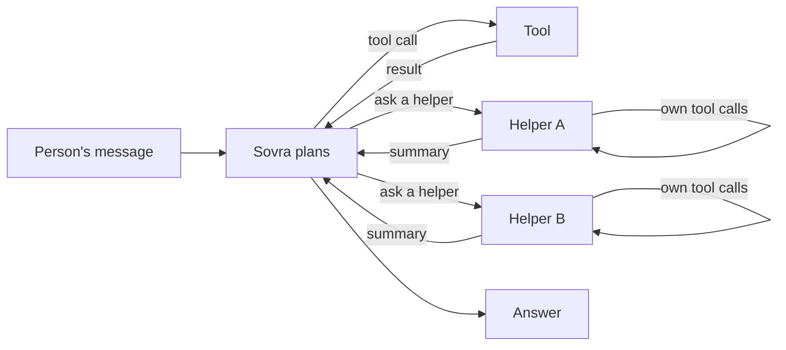

# The agent loop

How Sovra's helpers reason and act, which guard rails every loop runs under, and
how the person sees each step while it happens.

## What the loop is

Every helper in Sovra is a model in a **ReAct loop**: it reasons, calls a tool,
reads the result ("the observation"), and repeats until it can answer. Modern
models do this through native function calling, so Sovra never parses
"Thought: / Action:" text. ADK (`adk-agent`'s `LlmAgent`) runs the loop. The
rules and the progress log are pure, in `sovra-core/src/work.rs`.

The parent ("Sovra", `OrchestratorAgent`) delegates to specialist helpers
through ADK `AgentTool`s. Independent helpers run **at the same time**
(`parallelize_agent_delegations`, at most four at once, see
`run_config`). A helper whose tools are all read-only and concurrency-safe uses
ADK's `Auto` strategy, so its safe reads run together and ordered calls keep
their order. Team members use the same rule.

## Guard rails (every loop)

`work_log::harden` applies the same limits to the parent, every specialist,
every team member and every deep-research helper:

| Guard | Value | Why |
| --- | --- | --- |
| Step cap (`max_iterations`) | parent 25, helpers 25, team members 10 | ADK's default is 100 model calls. A hard cap guarantees the loop ends, and the person pays for every call on their own key. |
| Circuit breaker | 3 consecutive failures | A broken connection should not consume every remaining step. The model is told the tool is switched off, so it can adapt. |
| Repeat guard (`RepeatGuard`) | 3 identical calls per invocation | The most common runaway loop is the same call with the same arguments. The fourth identical call is refused with a message telling the model to use the earlier result or change course. Argument key order does not matter. |
| Step-limit message | `STEP_LIMIT_MESSAGE` | Hitting the cap is not a crash. The person is told plainly that Sovra stopped to save their credit, and how to continue. |
| Tool timeouts | terminal approval + command | A call that waits for the person's approval gets enough time. Other tools use ADK's default timeout. |
| Cancellation | **Stop** → `Runner::interrupt` | Stopping drops running and queued helper work (`concurrency_tests`). |

Tool errors are returned to the model as observations (ADK `{"error": …}`),
never thrown away, so the model can recover. Calls with side effects are not
retried automatically: a retried send or save could happen twice.

## Showing the work

Anthropic's guidance is to show the agent's planning steps explicitly. Sovra
streams the loop as the AG-UI `ACTIVITY_SNAPSHOT` event with activity type
`sovra.work` (`LiveActivity::Work(WorkActivity)`). AG-UI activity messages are
meant for live, replaceable progress.

- **One log per reply.** The workspace reducer puts the log on the reply being
  written (`AgUiWidget::WorkLog`), above its answer, and replaces it in place
  with each snapshot. A reply that used no tools shows no log.
- **Plain words.** `describe_step` turns each call into a sentence: "Searching
  the web for “soup recipes”", "Reading budget.xlsx", "Asking the Web Search
  helper about “…”". A tool it does not know (an MCP tool, say) still reads
  as words ("Using render table"), never as JSON. Arguments are clipped
  to a short quote.
- **Parallel helpers have lanes.** Each request to a helper opens its own lane
  (`WorkHelper`), keyed by the request, so the same helper asked two things at
  once shows two lanes. Each lane shows what the helper is doing *now* and its
  step count. When several steps run at once, the status says so: "Doing 3
  things at once — …".
- **A helper's own steps are visible.** `AgentTool` forwards a child's events
  through the parent's tool context. `work_log::StepTap` wraps that context and
  re-emits only *who called which tool* as content-free, **partial** events.
  ADK never persists partial events, so the parent's history (what the model
  reads next turn) is unchanged.
- **Durations and totals.** Each step records start and finish times as
  milliseconds from the start of the turn. The closed log reads "Worked
  through 6 steps with 2 helpers in 14s", or "Stopped after …" when the turn
  ended early. A snapshot keeps at most 60 steps and counts older ones, so
  long turns stay small in memory and in saved chats.

## Teams: a kanban board, members side by side

A team turn ([Teams and artifacts](teams-and-artifacts.md)) runs in rounds. All
members chosen for a round now **answer at the same time**. Each sees the
conversation as it stood when the round began, and their replies stream into
separate messages together. The Conductor then reads every reply and decides
whether another round helps. This is the parallel "sectioning" and
orchestrator-workers pattern. Reply slots and AG-UI ids are handed out before the
round starts, so the reply cap and every id are deterministic.

The team card (`activityType: "sovra.team"`) is a kanban board with
**Waiting / Working / Done** lanes (`TeamActivity::lanes`). Each member card
shows its latest tool step ("Searching the web for …") and step count. A card
moves to Done the moment its member finishes, while the others keep working.
Replies streaming into the chat push that card out of view, so while the turn
runs the same board is also **docked above the chat box** as compact lanes of
member chips ("Priya · Searching the web for …"), and the dock gives the space
back when the turn ends. Found by driving the running app: before the dock, a
person could not see the board at all while their team was answering.

## Sources

- Anthropic, [Building effective agents](https://www.anthropic.com/engineering/building-effective-agents):
  agents are models using tools in a loop; use stopping conditions such as a
  maximum number of iterations; gain ground truth from the environment at each
  step; show the agent's planning steps; parallelisation (sectioning, voting)
  and orchestrator-workers.
- Anthropic, [How we built our multi-agent research system](https://www.anthropic.com/engineering/multi-agent-research-system):
  3–5 subagents in parallel and parallel tool calls cut research time by up to
  90%; scale effort to the task; tell the agent when a tool is failing so it can
  adapt; guard rails stop agents spiralling; trace the system.
- Anthropic, [Writing effective tools for agents](https://www.anthropic.com/engineering/writing-tools-for-agents):
  simple while-loops of model and tool calls; clear, actionable tool errors.
- AG-UI, [Events](https://docs.ag-ui.com/concepts/events): lifecycle, text, tool
  call, activity (`ACTIVITY_SNAPSHOT` / `ACTIVITY_DELTA`) and reasoning events.
- Industry write-ups on ReAct loops consistently recommend hard step caps,
  several stop conditions, native function calling over text parsing, and
  explicit tool-error handling. For example, Data Science Dojo's
  [agentic loops guide](https://datasciencedojo.com/blog/agentic-loops-explained-from-react-to-loop-engineering-2026-guide/).
