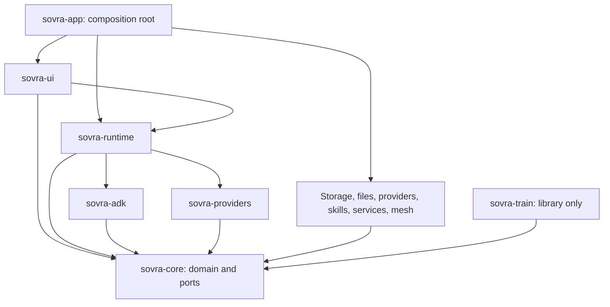
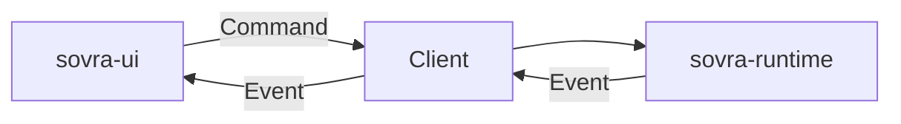

# Architecture

SovraHarness is a Rust workspace with a native GPUI UI, a background runtime, and
adapters for storage and external services. The allowed dependencies are defined
in [xtask/src/deps.rs](../xtask/src/deps.rs) and checked by `cargo xtask check-deps`.
The engineering rules are in [AGENTS.md](../AGENTS.md).

## Crate boundaries

| Crate | Responsibility |
| --- | --- |
| `sovra-core` | Domain types, commands/events, pure state reducers, validation, and adapter ports |
| `sovra-runtime` | Owned async tasks, cancellation, orchestration, and UI event delivery |
| `sovra-ui` | GPUI views, native controls, accessibility, and design tokens |
| `sovra-app` | Process startup, installer hooks, configuration, paths, and service wiring |
| `sovra-adk` | Model harness, helper delegation, tool adapters, and context admission |
| `sovra-providers` | Model catalogs, connection metadata, credentials, and authentication |
| `sovra-store-surreal` | Embedded SurrealDB implementation of `MemoryStore` |
| `sovra-files` | Managed attachments, document readers, and SQLite folder indexing |
| `sovra-skills` | Imported skill packages and bounded YAML parsing |
| `sovra-google`, `sovra-github` | OAuth/token setup and service APIs behind core ports |
| `sovra-whatsapp`, `sovra-telegram` | Messaging adapters behind `MessagingChannel` |
| `sovra-mesh` | Group storage, signatures, peer transport, and audit replication |
| `sovra-train` | Burn training adapter; library code, not wired into the desktop app |
| `xtask` | Checks, development launch, hooks, and packaging |

The graph summarizes ownership; the dependency table includes the exact allowed
normal, build, and test edges. Add crates for a real boundary or dependency set.
Configuration is read in `sovra-app` and passed down. Core defines async port
traits where needed but does not own an async runtime or perform IO.

## UI and runtime protocol

The UI sends `sovra_core::Command` values and receives `sovra_core::Event` values
through `sovra_runtime::Client`. There is no shared mutable UI/runtime state.
Tokio runs on a background thread; views use GPUI's executor and retain their
subscription/task handles. Headless UI tests use `Client::loopback()`.

For a new capability, define its protocol and rules in core, perform IO through
the runtime/adapters, and render the state in UI. Register user-facing capabilities
in the Skills catalog; see [contribution rules](../CONTRIBUTING.md).

## Persistence and credentials

The composition root opens embedded SurrealDB through `MemoryStore`; only
`sovra-store-surreal` names that dependency. The desktop uses a local SurrealKV
store. A remote database service is not exposed as a desktop configuration option.
The adapter owns schema application and migrations. Startup reports memory-store
failures and can continue without memory.

Conversation evidence, interpreted facts, temporal corrections, and withdrawal
are described in [Memory capture and recall](memory-capture-and-recall.md).
Folder indexing uses its own SQLite catalog and search data; it is separate from
chat memory. See [Files](files.md).

Installed/release keys use the OS keychain. Debug `SOVRA_DEV=1` uses separate
plaintext development files outside the checkout. Local accounts are workspace
sign-in records, not independent encrypted stores. See
[Configuration](configuration.md) and [Security](../SECURITY.md).

## UI and build dependencies

GPUI is confined to `sovra-ui` and pinned exactly in the workspace manifest.
Its API must be checked against the pinned source when changing views. The
native theme, embedded SVG logo, and responsive layout contract are in
[Styling](styling.md).

All workspace dependencies and lints are declared in [Cargo.toml](../Cargo.toml).
The current profiles keep line tables for workspace crates, optimize dependency
builds, use thin LTO for releases, and provide a `profiling` profile. Consult the
manifest for exact settings instead of copying them into crate manifests.

Library boundaries use `thiserror`; the composition root and xtask use `anyhow`.
Structured logging uses `tracing` and daily rolling logs. The workspace forbids
unsafe code; this does not claim that third-party dependencies contain none.

## Distribution: Velopack

`VelopackApp::build().run()` handles installer hooks at the start of `main`.
`cargo xtask dist` packages the host platform; GitHub Actions builds release
assets for macOS, Windows, and Linux. Signing is conditional on configured secrets.
In-app update checking is not implemented. Follow [Releasing](releasing.md).

## Checks and tests

`cargo xtask ci` runs formatting, Clippy, dependency-layer and styling checks,
documentation checks, cargo-deny, cargo-shear, and workspace tests. CI also checks
platform builds; a local pass does not replace target-platform verification.

- Pure rules are tested next to core code.
- Runtime tests drive `Client` and inspect emitted events.
- UI tests use headless GPUI and loopback events.
- Live native verification uses [Development MCP](development-mcp.md).
- Optional model and performance evaluations are documented separately in
  [Memory evaluation](agent-memory.md) and [Retrieval benchmarks](knowledge-benchmark.md).

License and advisory exceptions remain in [deny.toml](../deny.toml), with
version-specific [license evidence](dependency-licenses.md). These policies are
not waived by a successful build.
