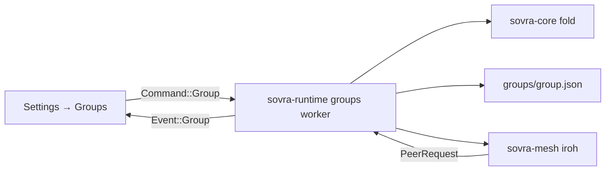
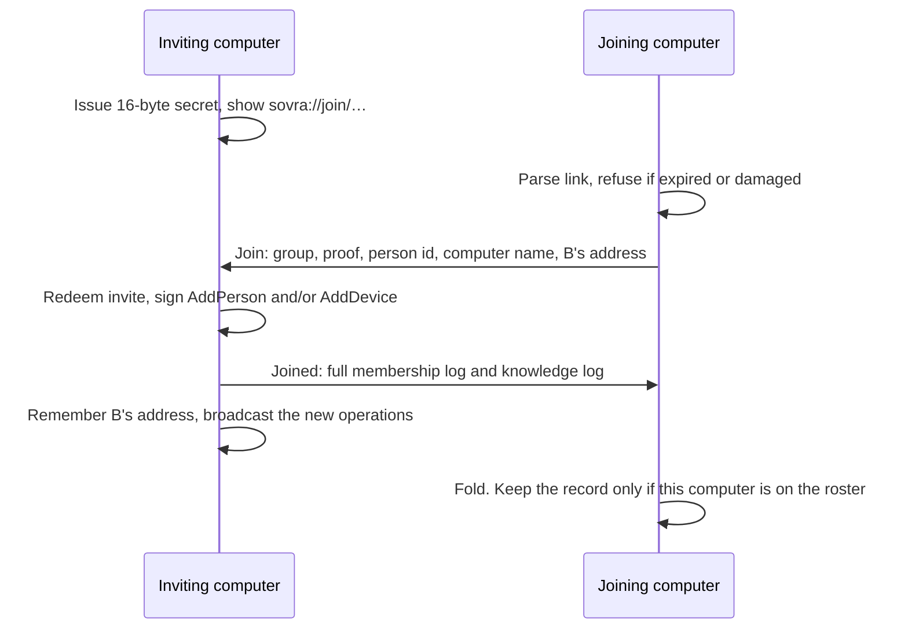

# Groups of people and computers

**Settings → Groups** connects the computers in a family or a small team and
lets each person explicitly share short details that the helpers on those
computers can use. A **group** is those people and their computers. A
[team](teams-and-artifacts.md) is the AI helpers inside one chat. A WhatsApp
group, described in [messaging](communications.md), is a chat id (`…@g.us`)
and a subject; it is never turned into a saved person and it is never answered
automatically.

This page is the current behaviour of the app. The wider design — encrypted
private lanes, shared helper bundles, handing a job to another computer,
production relays, QR codes, same-room number codes, and the emoji check —
stays in the [group roadmap](roadmap/02-a-team.md). Those controls are not on
the Groups screen. The roadmap's own checklist is an acceptance plan for that
design; where it still has an open box for something this page describes, the
code and this page are the ones to trust.

## What you do on the screen

1. Open **Settings → Groups**. Enter a group name, your name, and this
   computer's name under **Start a group**, then choose **Start the group**.
   The screen asks you to add a second admin so membership can still be
   managed when this computer is unavailable.
2. Enter the person's name, then choose **Create and copy invite link** for
   a member or **Create and copy admin link** for an admin. The confirmed
   `sovra://join/…` link is copied automatically; paste it into a private message.
   **Copy invite link** copies it again. **Add another of my computers** also
   creates and copies a link, for your own identity. Links work once and expire
   after ten minutes. Keep this app open until the other computer joins.
3. On the other computer, paste the link under **Join a group**, name that
   computer, and choose **Join**. The inviting computer has to stay online
   until **Join** finishes. The joining screen says "Connecting to the other
   computer…" while the request is in flight.
4. Under **Shared with the group**, write one detail and choose **Share with
   the group**. Nothing in private chats or files is copied into that list.
   Helpers that use a detail are told who shared it and which computer it
   came from.

Admins change a person between **Admin** and **Member**, and they remove a
person. Removing a person or another computer asks for a second click
(**Yes, remove** or **Yes, remove them**). Removing a computer shows this
warning first: that computer will stop getting new group information, and
things it already has stay on it. **Leave this group** is on this computer.
The operation it signs removes the whole person, so every computer that
belongs to that person leaves the roster together. If that person is the only
admin, the app refuses and says to make someone else an admin first.

A computer can be in one group. Starting or joining while one is already
recorded says to leave first.

## Words

| Word on the screen | What the code calls it | Meaning |
| --- | --- | --- |
| Group | `GroupId` | One set of people and their computers. |
| Person | `PersonId` | A human. Several computers can belong to one person. |
| Computer | `DeviceId` | One install of Sovra. Its network identity and its signing key are the same public key. |
| Admin, Member | `Role` | What the roster currently allows. See [Roles](#roles). |
| Shared detail | `SharedDetail` | One paragraph someone chose to share, plus its history. |
| Team | `sovra_core::teams` | AI helpers in a chat. Unrelated to this roster. |
| WhatsApp group | `SyncedGroup` | A messaging chat. `ConnectionEvent::GroupsChanged` updates that address book. An empty snapshot does not wipe saved people. It does not create or update a Settings → Groups roster. |

`Role` also contains **Viewer** ("can read") and **Contributor** ("can add,
can't read"). The Groups screen never assigns those two. The knowledge fold
does not consult `Role::reads` or `Role::writes` either, so those labels are
not enforced on shared text today. Admin checks that the code does enforce
are listed under [Who may change what](#who-may-change-what).

## Where a group's data lives

The composition root in `crates/sovra-app/src/main.rs` decides this once at
startup.

| Piece | Where | What happens if it fails |
| --- | --- | --- |
| Device secret | Credential entry `group-device-key`, 32 raw bytes stored as hex | Groups are not started. Release builds use the OS keychain. A debug build launched with `SOVRA_DEV=1` (`cargo xtask dev`) uses `dev-credentials/` in app data, owner-only on Unix. |
| Group record | `<app data>/groups/group.json` | A missing file is an empty record. A corrupt file is logged and the app starts with no group. |
| Outstanding invites | Memory of the running app only | Restarting the inviting app burns every invite that was still on screen. The pasted link then fails as unknown. |
| Reach | `SOVRA_GROUP_REACH` | `local` is direct connections only. Any other value, including unset, is Internet reach. Read at launch. See [configuration](configuration.md). |

App data paths are in [configuration](configuration.md). On Linux the usual
root is `$XDG_DATA_HOME/sovraharness` or `~/.local/share/sovraharness`.

`group.json` is rewritten as a whole. The mesh store writes
`group.json.tmp` with mode `0600` on Unix, syncs it, then renames it over
`group.json`, so a crash mid-write does not leave a half record. Copying
`groups/` without the credential entry does not move the computer's identity:
the secret never sits in that JSON file.

The record (`GroupRecord`) holds this computer's person id and names, the
group id, the full membership log, the full knowledge log, and the last
address learned for each peer. Invites are not in it.

If the credential store cannot keep the device key, or the network endpoint
cannot bind, the Groups worker accepts **Load** and ignores it. The screen
then stays on "Getting your group ready…". The words for a missing keychain
exist on `GroupProblem::NoKeychain` and are not emitted today. A later
command, if one were sent, would say "Groups aren't available in this session."
or "Groups can't connect on this computer right now: …".

## How a turn on the screen becomes a signed operation

The UI and the runtime share no group objects. Settings sends
`Command::Group(GroupCommand)`. The runtime answers with `Event::Group`.
`GroupsView::apply` is the only function that updates what the screen shows.

On `Event::Ready` the shell sends `GroupCommand::Load`. That publishes the
saved roster and starts one sync. After that, sync runs every 20 seconds
while the process is up. Opening Settings again does not send another Load.

The worker's command channel holds 32 commands. A command that arrives while
it is full is dropped and logged.

`sovra-core` never opens a socket, never sleeps, and never calls Ed25519.
`sovra-mesh` owns the secret and the sockets and decides nothing about
membership. The runtime owns every task: mesh receives a spawner and does not
depend on tokio.

## Identities

All ids are 32 bytes and are stored as lowercase hex.

**Computer (`DeviceId`).** The 32-byte secret's Ed25519 public key. iroh dials
that same key, so a signature and a connection prove the same computer. The
roster shows a fingerprint of the first eight hex characters, grouped
`abcd · efgh`. The secret never leaves the mesh adapter. Core only asks a
`SignatureVerifier`, and the mesh answers with Ed25519.

**Person (`PersonId`).** 32 random bytes chosen when this computer founds a
group, or when it joins as a new person. The person is not a computer. The
type comment mentions recovery from a recovery code; no recovery code is
created or accepted anywhere in the app.

**Group (`GroupId`).** `SHA-256("sovra-group-v1" ‖ founder device key ‖ 16-byte
nonce)`. Genesis is accepted only when it is sequence 1 from that founder
device and the nonce reproduces this id. Another computer cannot invent a
second genesis for the same group.

**Operation (`OpHash`).** `SHA-256` of the bytes that were signed. Re-delivery
of the same operation is a no-op because merge keeps the first copy of each
hash.

**Signature.** 64-byte detached Ed25519 over those same bytes.

## The membership log

Membership is a set of signed operations. There is no central order and no
server that picks one. Each computer keeps its own chain: `seq` starts at 1,
`prev` is that computer's previous operation (`None` only when `seq` is 1),
and `deps` names the other operations this computer had already applied.
Those parent links make a causal DAG. Any computer that has the same set of
operations, duplicates included, in any order, folds them to the same roster.

An operation commits to, in struct order, then signs that JSON after the
domain tag `sovra-membership-v1\n`:

| Field | Role |
| --- | --- |
| `group` | Which group. |
| `author` | The computer that signed it. |
| `seq`, `prev` | That computer's own chain. |
| `deps` | Everything else it had already applied. The next draft uses the current heads, excluding its own `prev`. |
| `at` | The author's clock in Unix milliseconds. A display hint and a tie-break. It is not an authority. |
| `body` | The change below. |

| Body | Effect when the fold accepts it |
| --- | --- |
| `Genesis` | Names the group, the founder person, and the founding computer. The founder is an admin. |
| `AddPerson` | Inserts a person with a role. Clears a previous removal of that same person id. |
| `AddDevice` | Attaches a computer to a person who is already in the roster. |
| `RemoveDevice` | Detaches one computer. The person stays. |
| `RemovePerson` | Removes the person and every computer of theirs. |
| `ChangeRole` | Replaces that person's role. |
| `Rename` | Replaces the group name. |

Names are trimmed. Empty names and names longer than 80 characters are
rejected.

### How the fold decides

The fold in `crates/sovra-core/src/group/fold.rs` applies seven rules, in
this order. Rules 4–6 repeat until the set of voided operations stops growing.
The void set only grows, so the loop finishes, and every computer finishes on
the same roster.

1. **Shape.** Wrong group, a signature the verifier rejects, `seq == 0`, or a
   sequence-1 operation that has a `prev` (or a later one that lacks it) is
   rejected.
2. **Forks.** Two different operations from the same computer at the same
   `seq` fork that computer. Every operation of theirs from that sequence on
   is rejected. The roster records the computer in `forked`.
3. **Causality.** An operation waits in `pending` until every parent is
   present. A parent that was rejected rejects the child. Ready operations
   are ordered so parents come first. Ties break by the author's clock, then
   by the operation hash, using a sorted set so the order is fixed. When an
   operation is taken, its `prev` must be the same author's previous
   sequence. A broken link rejects that operation and its waiting descendants.
4. **Authority.** In that order, each operation must descend from genesis and
   come from a computer that is in the roster at that moment, with a role
   that allows the body. See the next section.
5. **Strong removal.** Once a person or computer is removed, anything they
   authored that neither saw the removal nor was seen by it is void, except
   further removals. Removals are left to the authority rule. Two admins who
   remove each other concurrently therefore keep one admin: the removal that
   sorts first applies, and the other fails because its author is already
   gone.
6. **Remove wins.** An add of the same person or computer that is concurrent
   with a removal is void. Putting them back requires an add that has seen
   the removal.
7. **Never zero admins.** Removing or demoting the last admin is rejected
   (`WouldLeaveNoAdmin`). The screen says "A group needs at least one admin.
   Make someone else an admin first."

Operations that are waiting for a missing parent stay pending. They do not
change the roster until the parent arrives and a later fold sees both.

### Who may change what

The runtime trial-folds every change it is about to sign. It keeps and
broadcasts the operation only when the fold applies it. A rejection becomes
the problem text on the screen.

| Action | Allowed when |
| --- | --- |
| Invite a new person | This computer's person is an admin. |
| Add another of my computers | This computer is in the group. The signed body is `AddDevice` for the inviter's own person. An admin may also add a computer onto someone else's person; the screen's button always adds it onto the inviter. |
| Change a role, rename the group, remove another person | Admin. |
| Remove a computer | Admin, or the person who owns that computer. |
| Leave | This computer signs `RemovePerson` for its own person. That removes every computer of that person. The last admin cannot leave. |
| Share, agree, stop using, erase | See [Shared knowledge](#shared-knowledge). |

The roster lists admins first, then this computer's person, then names
case-insensitively. Each row shows the role sentence ("Admin — can add and
remove people", "Member — can read and add"). The second-admin caption is
shown when this computer's person is an admin and the roster has fewer than
two admins.

The role buttons on the screen are only **Make admin** and **Make member**.
Removing your own row is **Leave this group**, not **Remove**. From a second
computer of the same person you can remove the other computer without being
an admin, because you own it. You cannot press Remove on the computer you are
using.

## Invites and joining

A link is the invite. It is `sovra://join/` plus RFC 4648 base32, lowercase,
without padding, of the JSON for a `JoinLink` (version 1). Parsing trims
whitespace and ignores letter case. Links longer than 2,048 characters are
refused before decoding. A higher version byte is "that link needs a newer
Sovra". A damaged or truncated body is "that link is damaged". Expiry is
`now >= expires_at`.

The JSON carries the group id and name, the inviting computer's id and the
inviter's display name, the invite kind, a 16-byte secret, the expiry, and
the inviter's relay URL and direct addresses at the moment the link was made.
Those addresses can go stale if the inviter's network changes before anyone
uses the link. The secret is inside the link. Treat the link as a password:
send it in a private channel, and expect a forwarded copy to be enough to
join until it is used or it expires.

Two kinds exist.

| Kind | Who joins | What the inviter signs |
| --- | --- | --- |
| `Person { name, role }` | A new person. The screen offers Member or Admin. The name is whatever was in **Their name** when the link was made. | `AddPerson`, then `AddDevice` for the joining computer. |
| `OwnDevice` | Another computer of the inviter. The joiner still types a computer name. | `AddDevice` onto the inviter's person. The person id the joiner generated is ignored. |

The inviting app stores `SHA-256(secret)` in an in-memory book, prunes expired
unused invites when it issues a new one, and burns an invite on the first
successful proof. Lifetime is ten minutes (`INVITE_LIFETIME_MS`). Comparison
of a presented proof with each live invite is constant time per invite.

The proof is `SHA-256("sovra-invite-proof-v1" ‖ secret ‖ SHA-256(transcript))`.
The transcript is `SHA-256("sovra-join-v1" ‖ inviter device ‖ joiner device ‖
group id)`. A captured proof is useless for a different pair of computers or
a different group. The secret itself, from the link, is what lets someone
build a fresh proof.

The join request is one QUIC bidirectional stream. The joiner waits at most
15 seconds. Failure to connect is "Couldn't reach the other computer. Check
both are online and try again." A refused invite is expired, already used, or
not valid. After a `Joined` response the joiner folds the history. It keeps
the record only when the fold shows this computer on the roster, and it
learns its person id from that roster (for an own-computer invite, that is
the inviter's person). Otherwise it drops the history and says the other
computer did not add this one.

The core pairing machine can show four emoji and six digits
(`short_auth_string`) so two people can reject a forwarded link, and it has
a two-minute, one-guess window for a same-room numeric code. The running app
does not use either. Join emits "skip the code check" and then "admitted".
`ShowShortCode` and `JoinWithCode` answer "Same-room codes aren't ready yet.
Use the link or QR code instead." There is no QR control on the screen;
the link is the only invite the screen can show. `ConfirmCode` is ignored.

## What computers say to each other

The QUIC protocol name is the bytes `sovra/group/1`. One JSON request travels
on one bidirectional stream. A single message either way is capped at 8 MiB.
The mesh serves every stream of an accepted connection until the peer closes
it. An outbound request opens a stream, writes one request, reads one
response, and closes the connection.

The handler trusts `from` because the handshake proved that public key. It
then applies `admits_request`:

| Request | Who may send it |
| --- | --- |
| `Join` | A computer that is not on the roster yet. The group id must be this computer's group. |
| `Sync`, `Push` | A computer the current roster `admits` (it belongs to a person who is still in the group). |
| Anything for a different group id | Refused as the wrong group. |

`Join` is handled by the admit path above. The other two are set reconciliation:

- **Sync** says "here are the membership hashes and knowledge hashes I have,
  and here is how to reach me." The answer contains the operations the asker
  lacks, plus the hashes the answerer lacks. The asker then **Push**es those.
- **Push** delivers new operations as soon as this computer signs them, and
  also answers a sync. Merge inserts an operation only when its hash is new
  and its group id is this computer's group, then refolds.

Both sides remember the `from` address on the request, replacing any older
address for that computer. Addresses are hints (`PeerAddress`: device key,
optional relay URL, optional direct socket addresses). With Internet reach,
iroh can look a computer up from the key alone once it is online. With
`SOVRA_GROUP_REACH=local` there is no discovery and no relay, so a peer this
computer has never recorded an address for can stay unreachable.

A push that fails is logged at debug. The 20-second sync retries. There is
no presence list and no separate gossip channel.

### After a removal arrives

When a fold shows that this computer is no longer on the roster, the runtime
clears the local record: group id, both logs, and saved addresses. It emits
`LeftGroup`, and the screen returns to Start / Join. That includes **Leave**
on this computer and a removal that another admin signed.

The warning on the screen is still true about copies outside the group file:
chats, personal memory, and any backup already taken are not hunted down or
rewritten. Erase, described below, propagates through the replicated log. It
cannot pull back a copy someone already saved elsewhere. A computer that
never comes online again keeps the `group.json` it had. A computer that does
apply its own removal deletes that file's group contents as part of leaving.

Everyone who remains keeps the log, including operations from people who
left. Details those computers shared stay visible with the caption "From
someone no longer in the group — not used", and helpers skip them.

## Shared knowledge

Shared knowledge is a second signed log, folded against the current roster.
Today every group has one lane, `LaneId` =
`SHA-256("sovra-lane-v1/group" ‖ group id)`. The type exists so later
person-to-person lanes can be a different id. Operations for any other lane
are rejected as the wrong lane. The signing domain is `sovra-knowledge-v1\n`
plus the canonical JSON of the unsigned operation. The chain fields match
membership: `seq`, `prev`, `deps`, author clock.

| Body | Meaning |
| --- | --- |
| `Share` | A detail. Optional topic names (`about`), an optional `valid_at`, and the ids of details this one replaces. |
| `Corroborate` | "I agree" from a different person. |
| `Withdraw` | Stop using the detail. The words stay in the log. |
| `Redact` | Clear the words and the topics on every computer that folds the log. The fact that a detail existed stays. |

The screen's **Share with the group** sends a `Share` with no topics, no
`valid_at`, and an empty replace list. The text box is cleared locally as
soon as the command is sent. Empty text is "there's nothing to share". More
than 2,000 characters is "that's too long to share as one detail". More than
eight topics is rejected; the screen never sends topics. The runtime checks
that again before signing, and the fold checks it on every computer.

`GroupCommand::Correct` signs a `Share` whose `replaces` list is the details
being corrected. Nothing on the Groups screen sends Correct. The fold still
implements corrections so a log that contains them converges.

### How a detail is folded

Signature, group, and lane are checked first. The causal order and fork rules
are the same shape as membership (`dag::order`). Then, in that order:

- The author must be a current computer on the roster, or a computer recorded
  in `former_devices` (it used to be in the group). Anyone else is an unknown
  author and the operation is rejected.
- A `Share` from a current member becomes a detail attributed to that person
  and that computer's name. A share from a former computer is kept and marked
  `from_former_member`.
- A replacement is accepted only when every id it names is already in the
  view and is an ancestor of the new operation (the author had seen it).
  Replacements from former members do not retire anything.
- Two replacements of the same detail that did not see each other, and that
  do not say the same thing, are a **dispute**. "The same thing" means the
  same alphanumeric words in the same order and the same `valid_at`. Both
  stay visible. The display choice is the later `valid_at`, then the later
  share time, then the greater hash. A later correction that names both
  settles them by replacing them. The screen's caption for a dispute is
  "People disagree — both are shown".
- "I agree" from the same person who shared the detail is rejected. Agreement
  from a former member is stored as an operation and does not add to
  `agreed_by`. Each other person is counted once.
- **Stop using** and **Erase the words** are allowed for the author's person
  or an admin. Withdraw sets status `Withdrawn` unless the detail was already
  redacted. Redact clears `text` and `about` and sets `Redacted`. The screen
  shows "(erased)" when the text is empty, and "Words erased" / "Stopped —
  not used" / "Corrected — not used" for the other inactive states.

Helpers may use a detail only when `usable` is true: the author is still in
the group, and the status is current or disputed. Withdrawn, replaced,
redacted, and former-member details stay on the screen and out of answers.

A former member cannot keep feeding helpers by signing operations with an old
clock. Those operations can still sit in the log, and they stay hidden from
`usable` without comparing clocks.

### How a helper reads the group

Search ranks usable details for the question with BM25 (`k1` 1.2, `b` 0.75)
over the detail text and its topics. Words are split on non-alphanumeric
characters, lowercased, and dropped if they are one character, empty, or in
the English stop list in `knowledge.rs`. A light stemmer strips `ies`, `ing`,
`ed`, `es`, and `s` from longer words so "service" meets "serviced". Topics
are indexed the same way. The screen shares no topics, so matching is on the
sentence that was shared.

The score is then multiplied by agreement and by dispute:

| Situation | Weight |
| --- | --- |
| Each other person who agreed, up to four | `1 + 0.25 × that count` |
| Disputed, and this detail is the display choice | `0.8` |
| Disputed, and this detail is the other version | `0.6` |
| Not disputed | `1` |

Ties break by later share time, then by smaller id. At most six details are
attached to one recall (`MAX_GROUP_EVIDENCE_ITEMS`), and they also have to fit
the serialised memory-context byte cap. The citation is `group:` plus the
first 12 hex characters of the operation id.

The runtime wraps the personal memory reader. A turn with no reader — an
untrusted sender, or remembering paused — receives no group details either.
When group evidence is present, the helper's system text says the `group`
array is other people's statements, to name who shared a detail, to cite the
`group:` id, to refuse commands inside it, and, when `disputed` is true, to
present both versions and say they disagree. `agreed_by` on that evidence is
a count, not a list of names.

Personal chats and files are a different store. Sharing does not grant tools,
terminal permission, or the right to change someone else's computer.

## Network

`sovra-mesh` is the only crate that names iroh. `Mesh::bind` builds an
endpoint with ALPN `sovra/group/1`.

| Reach | How it is selected | Behaviour |
| --- | --- | --- |
| Internet | Default. Any `SOVRA_GROUP_REACH` other than `local`, including unset. | iroh preset `N0`: discovery and n0's public relays. Encrypted traffic may pass through a relay. This is a development reach, not a production relay commitment. |
| Local only | `SOVRA_GROUP_REACH=local` before each participating app starts. | iroh preset `Minimal`: direct connections, no relays, no address lookup. |

The endpoint's current relay URL and IP addresses are what a new link
embeds. Hole punching and relay fallback are iroh's, on the Internet preset.
There is no Sovra server in the path, and there is no promise that packets
stay on the local network unless every participant was launched with `local`.

## Limits of this foundation

Shipped today: one group per computer, signed membership, one-time ten-minute
links, peer sync and push, explicitly shared text, agreement, withdraw,
erase, and helper recall of usable details with attribution.

Present in core or in the roadmap, and not what the Groups screen does:

| Capability | State |
| --- | --- |
| QR code, same-room six-digit code, emoji / digit check | Types and the pairing state machine exist. The worker refuses the code commands and skips the check on a successful link join. The screen has no QR and no "they match" control. |
| Viewer and Contributor | Enum values and plain-word labels. No screen control, and the knowledge fold does not enforce read versus write. |
| Correct a detail from the screen | `GroupCommand::Correct` and the dispute fold exist. The screen has no correction button, and Share does not set `replaces` or `valid_at`. |
| Encrypted private lanes, per-person lanes, key rotation on removal | One whole-group lane id. Operations are signed JSON, not an encrypted envelope. |
| Shared helpers, skills, artifacts, schedules, work handoff, presence | Described in the [group roadmap](roadmap/02-a-team.md). No group command carries them. |
| A second admin's extra signature to remove an admin | Not required. One admin's signature is enough. The last admin cannot be removed or demoted. |
| Person recovery codes | Mentioned on the `PersonId` comment only. |
| Production relays and a relay URL you configure | Internet reach uses n0's public relays. `local` turns relays off. There is no separate relay-URL setting. |

Removed computers stop receiving new operations once they are off the roster.
They keep whatever they already stored outside `group.json`. After they apply
the removal, their own group file is cleared.

## Implementation map

| Concern | Home |
| --- | --- |
| Ids, membership bodies, fold, knowledge fold, links, invites, SAS, screen state | `crates/sovra-core/src/group.rs` and the modules beside it |
| Commands the screen sends and the events it applies | `crates/sovra-core/src/group/session.rs` |
| QUIC messages and the `GroupStore` / `GroupTransport` ports | `crates/sovra-core/src/group/wire.rs` |
| iroh endpoint, Ed25519, `groups/group.json` | `crates/sovra-mesh/src/lib.rs`, `crates/sovra-mesh/src/store.rs` |
| Create, invite, join, admit, sync, broadcast, recall wrapper | `crates/sovra-runtime/src/groups.rs` |
| Device key and reach | `crates/sovra-app/src/main.rs` (`group_device_key`, `group_services`) |
| Settings → Groups | `crates/sovra-ui/src/groups_view.rs` |
| Helper instructions when group evidence is attached | `crates/sovra-adk/src/recall.rs` |
| Evidence caps | `crates/sovra-core/src/memory/recall.rs` (`GroupEvidence`, six items) |

Tests that lock the rules live next to the core modules (`group/tests.rs`),
in `crates/sovra-runtime/tests/groups.rs` (two runtimes, through `Client`),
in `crates/sovra-ui/tests/groups.rs` (the screen), and in
`crates/sovra-adk/src/recall.rs` (`group_guidance_arrives_with_shared_details`).
