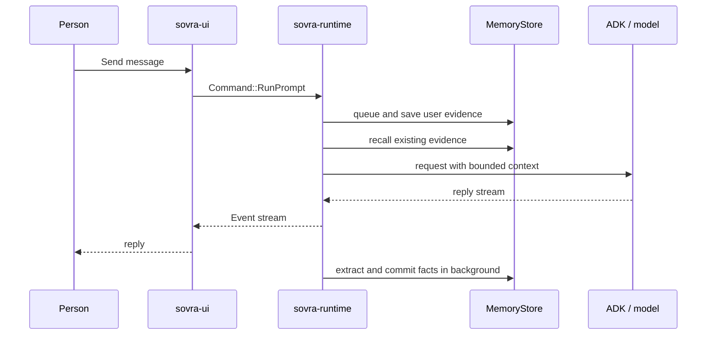

# Memory capture and recall

This guide explains the current chat-memory pipeline. For user controls, read
[Knowledge](knowledge.md). [Memory evaluation](agent-memory.md) documents the
optional tests; it does not establish a universal recall or answer-quality score.

## Stored evidence and facts

An **episode** records source text, authorship, conversation, and time. A **fact**
is a model interpretation of a user-written message or note with an exact source
quote and temporal metadata. Assistant output remains assistant evidence; it is
not relabelled as a personal statement by the user.

Corrections retain older facts and link the replacement. Stopping use excludes
evidence from recall while retaining history. These actions are not secure erasure.
Only `sovra-store-surreal` implements the database details behind `MemoryStore`.
Folder indexing is separate; see [Skills and folder knowledge](skills-and-file-knowledge.md).

## One ordinary chat turn

1. The runtime accepts the prompt and takes an interactive model slot. When
   remembering is enabled and the session has private access, it queues user
   evidence and retains a receipt for the source write. Private access includes
   the desktop and authenticated messaging-owner sessions; other senders are excluded.
2. The remembering worker saves the source and creates a durable processing job.
   Empty input is ignored; an already identified source is not queued twice.
   A full in-process queue applies backpressure. Queue acceptance alone is not
   proof that a disk write completed.
3. The reply uses existing saved evidence. It does not wait for new fact extraction,
   so a fact from this message may only be available on a later turn.
4. Background workers claim saved jobs when remembering is enabled and interactive
   model work permits it. Long input is chunked. Extraction receives source text
   and bounded preceding context, without tools or provider conversation history.
5. The model proposes facts. Core validation requires exact source quotes and
   enforces candidate/entity/text limits before a batch can be committed.
   The extractor is instructed to omit secrets, commands, quoted documents,
   fiction, and casual chatter; these instructions are not a perfect classifier.
6. Reconciliation can mark a fact as a correction (`replaces`) or repeat (`same_as`)
   without rewriting its quoted evidence. The store commits atomically, preserving
   history. An empty result saves no fact but retains the original source.

A matching quote establishes provenance, not truth or importance. A model can
misinterpret a genuine quote or omit a useful fact. Review the original record
when the distinction matters. Pause/reconfiguration invalidates stale extraction
results; failed jobs remain visible/retryable within the worker's bounded policy.

## Corrections and dates

`replaces` ends the prior fact's validity and adds a supersedes link. `same_as`
records another supporting source without ending the current fact. Reconciliation
cannot change the extracted content, quote, entities, or effective date.

Recorded time and real-world validity are separate. Undated statements retain
unknown validity dates. Historical reads use `valid_at` / `known_at` and avoid
mixing current background facts into a historical answer. Tentative plans are not
instructions to overwrite an established current fact.

## One team turn

The team's user prompt follows the same admission path. Visible member replies
are captured from AG-UI text events with the member's identity and run ID.
Moderation tails, hidden reasoning, and activity snapshots are not personal facts.
Incomplete or oversized reply capture fails rather than silently storing a cut-off quote.

A dependency tracker records source/fact inputs actually observed by the model.
Unknown lineage stays unknown: a model-written citation cannot certify its inputs.
Helper output can be eligible for cross-chat retrieval only when its dependency
manifest is complete and the store can resolve the supporting ancestors.
Untracked file/tool inputs prevent assuming a closed dependency set.

## A later question

For a private turn with remembering enabled, recall uses the current question's
terms, optional semantic search, raw-source search, and bounded background facts.
A question with no usable search terms does not invent a match. The initial
lexical query does not rewrite itself using earlier conversation turns; explicit
lookup tools can perform further bounded searches.

Fact ranking uses reciprocal rank fusion, then applies item/byte limits and source
validation. Meaning search is optional and needs an approved embedding service;
raw episodes are not embedded. Related facts can supplement primary matches.
Historical queries omit the current-fact background leg.

The injected context is labelled untrusted data. It is attached to that request,
not permanently appended to provider history. Source quotes are retained whole;
items that cannot fit are omitted. A pause or recall-policy change during a read
invalidates stale results. Missing evidence is not proof that the person never
said something, and an unavailable search must not be described as successful recall.

## How a citation opens its source

Replies can carry `[memory:fact:…]` and `[source:episode:…]` references. The UI
resolves the stored ID and opens the corresponding Knowledge record. A citation
is a navigation key, not proof that the answer follows from the source. Unknown
or unavailable references do not create evidence.

## How withdrawal blocks recall

- Stopping one fact excludes that fact.
- Removing a correction family stops the linked supersedes chain.
- Stopping an original source revokes its versions and stops facts derived from them.
- Helper replies with revoked dependencies are excluded; unsupported/unknown lineage
  is not treated as a clean empty dependency list.

Separately supported facts and repeat neighbors do not automatically disappear
when one fact is stopped. Knowledge can still display retained stopped records
for review. Revocation cannot retract text already sent to a model, shared, or
copied elsewhere. Pending extraction for a stopped source is cancelled and old
recall results are invalidated.

## Limits in force

| Boundary | Current limit |
| --- | --- |
| Initial recall | 2-second runtime deadline |
| Injected memory | 8 fact items and 16 KiB of encoded context; raw source/background content shares bounded budgets |
| Primary facts | Up to 6, leaving room for related facts |
| Lookup batch | Up to 4 searches |
| Extraction capacity | Default 4 slots; `SOVRA_MEMORY_EXTRACTION_SLOTS` uses the default for zero and is otherwise clamped to 1–16 |

Exact constants and validation are in [core recall](../crates/sovra-core/src/memory/recall.rs),
[ingestion](../crates/sovra-core/src/memory/ingestion.rs),
[runtime recall](../crates/sovra-runtime/src/recalling.rs), and
[remembering](../crates/sovra-runtime/src/remembering.rs).
Disabled meaning search contributes no semantic results. A semantic error can
fall back to lexical/source results with a notice. Overall recall failure can
return empty context rather than blocking or inventing remembered facts.

## Implementation map

| Concern | Source |
| --- | --- |
| Source admission and author identity | [admission](../crates/sovra-core/src/memory/admission.rs) |
| Extraction and reconciliation | [ADK memory](../crates/sovra-adk/src/memory.rs) |
| Durable jobs and storage lifecycle | [ingestion adapter](../crates/sovra-store-surreal/src/ingestion.rs), [lifecycle](../crates/sovra-store-surreal/src/lifecycle.rs) |
| Assistant capture and lineage | [runtime capture](../crates/sovra-runtime/src/memory_capture.rs), [dependency tracker](../crates/sovra-core/src/memory/dependencies.rs) |
| Request context and lookup tools | [ADK recall](../crates/sovra-adk/src/recall.rs) |
| Review controls | [Knowledge guide](knowledge.md) |
