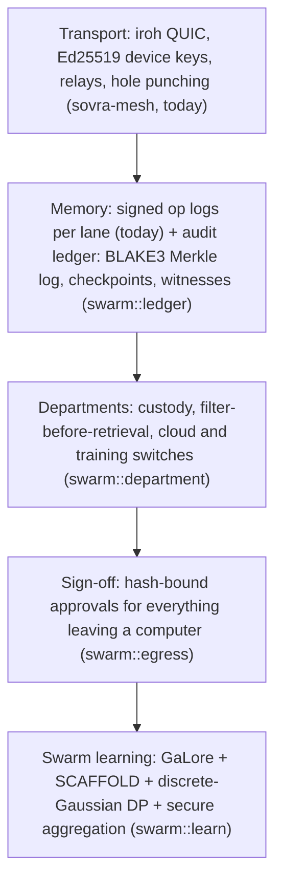

# The sovereign enterprise swarm

Status, 2026-11-11: the **rules and cryptography are implemented and tested**
(`crates/sovra-core/src/swarm/`, `crates/sovra-mesh/src/swarm.rs`).

*Today* in the app: every computer in a group keeps a **signed audit history**.
Each share it makes, and each memory it gives to another person's helpers, is
recorded. The history is re-verified on every start, and Settings → Groups shows
it under **History on this computer** (see [Groups](groups.md)). Histories are
replicated on every group sync (`PeerRequest::AuditSync`, `swarm::audit::FleetAudit`).
Every computer keeps checked, relayed copies of the others' histories, only a
history's author can extend it, and a computer that shows two different signed
histories is flagged.

Not yet in the app: departments, the sign-off gate for outbound messages,
syncing ledgers with witnesses, and training. The next steps are listed at the
end. This is the stage 3 ("a company") and
stage 5 ("collective intelligence") direction of the
[roadmap](roadmap/README.md) turned into code.

## What it promises

| Promise | What enforces it |
| --- | --- |
| **Zero rented infrastructure.** Documents, models and records stay on the company's own computers. | The ledger stores only BLAKE3 hashes and department ids, never payloads. Training sends only clipped, noised, masked updates. |
| **Departmental isolation.** Legal, finance and engineering each keep custody of their own memory. | `swarm::department::Directory`: search hits are filtered *before* ranking (`filter_for`), items replicate only to computers owned by department members (`may_replicate`), and cloud use and training are separate switches that start off. |
| **Immutable global auditability.** A shared, append-only history shows where every item lives and every model update. | `swarm::ledger`: signed, per-computer hash-chained entries in an RFC 9162 Merkle log (BLAKE3), signed checkpoints, witnesses that refuse forks and rollbacks, and a residency report folded from the history. |
| **Decentralised collective training.** The fleet fine-tunes company-owned models without exporting data. | `swarm::learn`: GaLore, SCAFFOLD, exact discrete-Gaussian DP with a zCDP budget, and double-masked secure aggregation. |
| **Human-in-the-loop.** Nothing an AI drafts leaves a computer without a person's sign-off. | `swarm::egress::EgressGate`: approvals are bound to the BLAKE3 hash of the exact bytes, release once, and re-check department rules. |

## Layers

### How this maps to the brief's stack

The brief named a specific stack. Where the code already had an owner-approved
equivalent (roadmap decisions D2, D3 and D6), the equivalent stays, and the
reason is stated here so it can be revisited.

| Brief | Here | Why |
| --- | --- | --- |
| Iroh + QUIC + Ed25519, gossip discovery | iroh 1.4 in `sovra-mesh`; mDNS on the same network; key-based lookup and relays across networks | Already shipped. `iroh-gossip` is the natural next step for fleet-wide discovery and checkpoint broadcast. |
| Automerge CRDTs | Signed, hash-chained operation sets with a pure fold (`sovra-core/src/group`) | D3: converges like a CRDT, and adds signatures, roles and dispute rules that Automerge does not have. |
| BLAKE3 content addresses | `ContentHash` (BLAKE3) for ledger entries, Merkle nodes, models and released content | D5. The group op log keeps its SHA-256 ids for compatibility. |
| Embedded LanceDB | SurrealDB's embedded vector index (`sovra-store-surreal`) | D6: one local index per computer, rebuildable from the log. A LanceDB adapter would sit behind the same `MemoryStore` port. |
| Burn + CubeCL | `sovra-train`: Burn 0.22.1 models behind the core `Objective` port; pure-Rust CPU by default, CubeCL wgpu with `--features gpu` | Training kernels stay in an adapter crate; the protocol around them is backend-neutral. |
| FedLore (GaLore) | `learn::galore`: projector, `GaloreAdam`, and shared per-round projectors for compact federated updates | The test checks the claim: Llama-7B Adam state is over 24 GB in bf16, and under 4 GB with rank 128. |
| SCAFFOLD | `learn::scaffold` (option II) | Only `Δy` is sent: the fleet derives the mean control update, `−c − mean Δy / (Kη)`, which halves both the traffic and the noise. |
| OpenDP ε-DP | Exact discrete-Gaussian sampler (Canonne, Kamath & Steinke 2020, the same family OpenDP uses), distributed noise (Kairouz, Liu & Steinke 2021), zCDP accounting | Integer noise composes exactly with masking. The OpenDP library itself is not linked. |
| Secure aggregation | Double masking (Bonawitz et al. 2017) over ℤ/2⁶⁴; X25519 pair seeds from device keys | Dropout recovery is built in. A computer answers one survivor list per round and refuses a second, different one. |

## One training round

1. **Plan** (`RoundPlan::new`). Every listed department must have
   `TrainingConsent::ApprovedExamples`. The unmask threshold is two thirds of
   the roster. Each computer's noise variance is calibrated so the round fits
   `budget.left() / rounds_left`, even if only the threshold survive and some
   computers collude.
2. **Train locally** (`ScaffoldClient::train`) on the department's approved
   examples. The data never leaves the `Objective`.
3. **Contribute** (`contribute`): clip to L2 `C`, quantise, add a
   discrete-Gaussian share, mask, and hold the upload in the `EgressGate`.
4. **Sign off.** An approver of that department approves the exact bytes; the
   gate releases them once.
5. **Aggregate** (`aggregate`): the budget is charged for the real survivors
   **before** anything is unmasked, then the survivors' reveals remove the masks.
6. **Record.** A `ModelRound` ledger entry records the model hash, its parent,
   the departments, the contributor count and the privacy cost: this is model
   lineage.
7. **Promote** (`promote`). An approver from **every** contributing department
   signs. Rolling back is one more signed entry, and `active_model` folds which
   model is in use.

The end-to-end test (`learn/round/tests.rs`) runs 30 computers in three
departments with conflicting data for 40 rounds at a total ε = 10 (δ = 10⁻⁵),
with one computer dropping out every round. Every upload is signed off and
every round is recorded. The model gets within 0.63 of the true optimum, from
4.68 at the start. Without noise, SCAFFOLD reaches it exactly; FedAvg on the same
data stays more than 0.5 away.

## Honest limits

- **Differential privacy at small scale costs accuracy.** With tens of
  computers, a useful ε is 4–10 and the model is visibly noisier (stage 3 §6).
  Measure against retrieval over shared lanes before training anything.
- **The coordinator is honest-but-curious.** Clients refuse to answer two
  different survivor lists, but there is no signed consistency round yet (as in
  Bonawitz et al. §4), and no Shamir sharing of self seeds. A computer that drops
  out *after* revealing nothing is recovered; a malicious coordinator that splits
  the fleet into two views is detected only when clients compare
  `survivors_hash` values.
- **Noise needs the OS random source.** `OsRandom` refuses to start without
  one. Test seeds are for tests only.
- **What a model learned cannot be guaranteed to vanish** when a contribution is
  revoked. It can be excluded from future rounds, and rollback is one entry.
- **Erasure:** a purge removes the payload and adds a `Purged` entry. The hash
  stays, by design.

## Next steps

1. Runtime: *done* for this computer's own history (shares and federated
   answers; `sovra-runtime/src/groups.rs`). Replication is *done*: copies swap
   on every sync, with fork detection. Witnessing is *done*: signed checkpoints
   are broadcast over iroh-gossip (`audit::AuditGossip`, `GroupTransport::gossip_*`),
   and peers co-sign checkpoints that match their copy exactly. Still to do:
   record AI handoffs.
2. UI: *done* for the Groups summary. Still to do: a full **Audit history** page (where each item lives, who read it, every
   model change) and approval cards that use `EgressGate` for outbound
   messages. Register both on the Skills page.
3. Departments in the group roster: *done* (`Space::Department`; see
   [Groups](groups.md)).
4. `sovra-train`: *done* for the first model. A Burn 0.22.1 `LinearModel`
   implements `Objective` with Burn autodiff on the pure-Rust CPU backend, or
   CubeCL (wgpu) with `--features gpu`. Tests show its gradient matches finite
   differences, and that 10 computers' private rounds lower the loss. Still to
   do: LoRA adapters on 0.5–3B models, and runtime scheduling of rounds between
   computers (trainers run only on AC power and when idle).
5. **Training screen (future feature, owner decision 2026-11-11).** The person
   running Sovra picks the open base model, with a licence that allows
   fine-tuning. Sovra does not choose a default. Which items may train it, such
   as an "OK to train on" mark per department, is still to be decided. Until
   this screen exists, no shared model is trained in the app.
