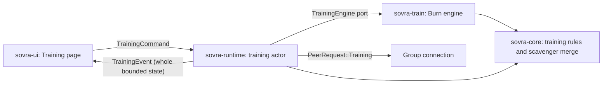

# Audit and training internals

This is a developer reference for code under `sovra_core::swarm`,
`sovra_core::training`, the mesh adapter, and `sovra-train`. To use training,
read the [Training guide](training.md).

## Integrated group audit

The desktop records group sharing and federated memory access in a signed,
hash-chained history. Group synchronization replicates checked copies, detects
conflicting histories, and uses signed checkpoints and peer witnessing.
**Groups → History** shows **History on this computer**. See [Groups](groups.md)
for the visible controls and limits.

Implementation: [audit rules](../crates/sovra-core/src/swarm/audit.rs),
[mesh adapter](../crates/sovra-mesh/src), and
[group runtime](../crates/sovra-runtime/src/groups.rs).

## Library components

| Component | Implemented responsibility |
| --- | --- |
| `swarm::department` | Department directory, membership, custody filters, and separate cloud/training consent |
| `swarm::ledger` and `swarm::merkle` | Signed ledger entries, Merkle roots, checkpoints, witnesses, and residency/model lineage folds |
| `swarm::egress` | Approvals bound to exact content hashes, checked and released once |
| `swarm::learn::galore` | Low-rank gradient projection and optimizer state |
| `swarm::learn::scaffold` | Local objective interface and control-variate training rules |
| `swarm::learn::privacy` | Discrete-Gaussian noise and zCDP accounting |
| `swarm::learn::secagg` | Masked aggregation and dropout handling |
| `swarm::learn::round` | Round planning, contributions, aggregation, and ledger events |
| `swarm::learn::scavenger` | Bounded independent work leases, token-weighted age-gated Adam merges, a settable step size, validated optimizer checkpoints in a compact binary form |
| `training` (core) | The Training product's pure domain: plans and presets, model shapes and the model file, metrics, hardware facts, the model library, group messages and the engine ports |
| `sovra-train::BurnTrainingEngine` | The `TrainingEngine` port: the Starter table and byte-level transformers, work packets, text writing, the saved-run format and the hardware probe |
| `sovra-train::ByteLanguageModel` | Burn next-byte cross-entropy/autodiff `Objective` used by library tests |
| `sovra-train::LinearModel` | Burn autodiff for a linear model with squared-error loss |

Source: [core modules](../crates/sovra-core/src/swarm/mod.rs),
[learning modules](../crates/sovra-core/src/swarm/learn/mod.rs), and
[training adapter](../crates/sovra-train/src/lib.rs).
The training adapter always uses Burn's pure-Rust processor backend (`flex`),
selected explicitly; it never reads `BURN_DEVICE`. Its `gpu` feature compiles
Burn's wgpu backend, which today only adds graphics card names to the hardware
facts: there is no graphics training path, and no workspace manifest enables
the feature. The composition root links the adapter into `sovra-app` through
the core `TrainingEngine` port; the runtime and UI have no Burn dependency.

## Training internals

The product is layered on the scavenger merge engine. Core decides and
validates, `sovra-train` does the arithmetic, the runtime owns tasks, files and
group exchanges, and the UI renders one bounded state snapshot.

### Models and the model file

`BASE_MODELS` is a data table of four rows. `Architecture { context, width,
layers, heads }` describes a shape, and `Architecture::blocks()` is the single
definition of how the flat `f32` parameter vector is cut into matrices; the
engine builds one tensor per block from it. `layers == 0` is the Starter table.

| Row | Shape | Parameters | Group training |
| --- | --- | --- | --- |
| Starter | 256 by 256 table of next-byte scores | 65,536 | Yes |
| Small | context 64, width 64, 2 layers, 4 heads | 137,216 | Yes |
| Medium | context 128, width 128, 4 layers, 4 heads | 875,520 | Yes |
| Large | context 256, width 192, 6 layers, 6 heads | 2,817,280 | No |

The transformers are pre-norm with causal self-attention, a GELU feed-forward
four times the width, learned positions and a separate output layer with a
bias. The count is `256W + CW + L(12W² + 13W) + 2W + 256W + 256`; a core test
pins it for every row and an engine test checks that the engine's layout has
the same length. The vocabulary is the 256 byte values, so there is no
tokenizer. Fresh transformers are initialised from the plan's seed with a
plain-Rust generator; the Starter table starts at zero.

A model file is a fixed 64-byte header (`SOVRAMDL`, version 1, starting point,
shape, lifetime rounds and tokens, last loss and check loss, parameter count)
followed by little-endian `f32` values. Its length is exactly
`Architecture::file_len()`, at most 16 MiB. `decode_model` and `inspect_model`
refuse a wrong length, an unknown version, an out-of-bounds shape or a
non-finite value. `ModelId` is the content hash of the file.

`group_capable` is `parameters <= 1,000,000`: the largest model whose work
packet and returned update each fit one 8 MiB group message, where bytes travel
as hex. A core test serialises the worst-case packet and update for every
group-capable row and asserts the bound. Large does not fit and chunked work
transfer is not built, so Large trains on one computer.

### Plans, presets and settings

`TrainingPlan` holds the name, `TrainingBase` (`Fresh(BaseModel)` or
`Continue(ModelId)`), `TrainingSource` (`Sample`, `Text`, `File(PathBuf)`), an
optional preset, `TrainingSettings` and `with_group`. Settings are whole
numbers (thousandths or millionths) so plans compare exactly.
`TrainingSettings::validate(architecture)` bounds every field and names the
first one out of range; `TrainingSettings::recommended(preset, architecture,
text_len, hardware)` fills a preset. The ranges and recommended values are
tabled once, in the [Training guide](training.md#advanced-reference).

Core validates a file source by name only. The runtime reads it on a blocking
task (regular file, bounded read, UTF-8, byte-order mark removed) and never
puts text in the published state: `TrainingState.plan` is a
`TrainingPlanSummary` with the source kind, byte count and file name.

### Rounds, the merge engine and the two optimizers

`GridSyncer` assigns short work leases to independent workers. A ready worker
can advance training without waiting for offline workers. Each lease binds the
job, worker, base model hash, round, step count, token budget and expiry. The
caller supplies monotonic time; expired slots can be reused. Leases are
consumed once, and altered assignments, duplicate submissions, invalid
dimensions, non-finite values and out-of-budget counts are rejected before any
merge state changes.

One round is one packet folded in. The session issues a lease for the next
piece of the learning text, a computer learns from it, and the difference is
merged:

- **Local optimizer** (`sovra-train`, plain Rust over the flat vector): SGD or
  Adam with weight decay and optional clipping, for `local_steps` steps of
  `windows` seeded windows each. Its state lasts one packet, because a packet
  does not carry optimizer moments.
- **Outer optimizer** (`GridSyncer`): clips each pseudo-gradient to a fixed
  norm, applies a cosine/exponential age gate, token-weights the update and
  steps Adam. Because Adam normalises magnitude, `outer_learning_rate_micro`
  is the real step size and the local rate mostly sets direction. The schedule
  (constant, cosine, warm-up then cosine) therefore drives the outer rate: the
  session calls `GridSyncer::set_learning_rate` before every merge.

An update older than `cutoff_rounds` is refused without touching the moments;
recommended plans use 128 rounds with a small age decay so that a helper is
not left behind by an owner training continuously. The owner's own rounds use
the same path on a reserved all-zero worker id and skip the hex encoding. The
merge engine is capped at 16,777,216 parameters and 64 simultaneous workers.

Token accounting is exact. A transformer packet teaches
`windows × min(context, text_len − 1) × steps` next-byte guesses and the
Starter `(text_len − 1) × steps`; both ends compute the number, it must fit the
lease's token budget, and a result reporting any other count is refused.

Every `check_every` rounds, on round 1 and on the last round, the session
measures the loss on the held-back tail (`check_split`, never issued in a
packet) and writes sample text. `stop_when_stalled` ends the run when the best
check loss is that many rounds old. Evaluation and writing use no autodiff
graph, and text writing does not use Burn at all.

### Saved runs

`TrainingSession::checkpoint` returns a binary file: `SOVRARUN`, version 3,
section lengths, a small JSON header (`TrainingPlanSummary`, text hash, cursor,
losses, sample, last metric point), the text, and `GridCheckpoint::to_bytes()`
(`SOVRAGRD`, 20 bytes per parameter: the value and two `f64` moments). Restore
checks every length before allocating, then the plan, text hash, shape, round
and cursor, and passes the merge state through `GridSyncer::restore`. Any
failure is `InvalidCheckpoint`; the runtime then shows the error once, keeps
the file and lets a new run start. In-flight leases are never restored, and
the lease counter moves forward, so helpers must ask again. The 0.5.0 JSON
checkpoints still restore, as a Starter run, and are saved in the new form
afterwards. The size cap is 96 MiB.

The runtime writes owner-private files through a temporary file, sync and
atomic rename under `training/`: the run file, a `notes.json` sidecar with the
chart history, a pointer to the latest run, and `models/<id>.model` with a card
JSON. An OS-held lock excludes a second training runtime from the directory.
The library scan skips and logs anything that does not validate and never
removes a file. Rollback to an older checkpoint is not detected.

### The training actor

One actor task owns the session. While a run is `Running` the session is moved
into a blocking task for a slice of about 200 ms of rounds, and the actor keeps
answering commands and group requests; anything that needs the session sets a
halt flag and waits for the slice. Slices stop for a chat turn
(`model_priority::busy()`). State is published at most every 250 ms, except
phase changes. A slice saves when a save is due: every 25 times the measured
cost of a save, between 3 and 60 seconds. The run is always saved on pause,
stop, completion and shutdown.

On completion, a `Stop` command or a stall, the actor exports the model, has the engine
inspect it, writes the file and card, and adds it to the library. A failed
export leaves the run saved and is retried on the next `Load`. Starting a new
run first exports an unfinished earlier run that has rounds.

### Group exchanges

Every message is a variant of `TrainingPeerRequest` / `TrainingPeerResponse`
inside the existing `PeerRequest::Training { group, work }`, so the ALPN and
the membership gate are unchanged. Each exchange is one bounded JSON request
and one bounded JSON reply over the authenticated group connection.

| Request | Reply | Served when |
| --- | --- | --- |
| `Status` | `Running(RunSummary)` or `Unavailable` | Owner grant holds |
| `Work` | `Assigned(TrainingTask)` or `Unavailable` | Owner grant holds |
| `Submit(TrainingResult)` | `Accepted(TrainingProgress)` or `Rejected` | Owner grant holds |
| `Offers { have }` (at most 64 ids) | `Offered` (at most 8 cards) | Sender is a current member |
| `FetchModel { model, offset }` | `ModelPart { total, bytes }` (at most 2 MiB) | Member, and the model is shared with that group |
| `Received { model }` | `Thanks` | Member, and the model is shared with that group |
| `Announce { models }` | `Thanks` | Sender is a current member; treated as a hint only |

Authorisation has three layers:

1. **Membership.** `admits_request` refuses a non-member (`NotAMember`) or a
   wrong group id (`WrongGroup`) before any training code runs. The sender is
   the connection's authenticated device key. The sending side checks that
   both computers are in the group before the request and again after the
   reply.
2. **Owner grant.** `TrainingState.sharing = Some(group)` is set only by
   `Start(plan)` with `plan.with_group`, in memory. It is cleared by
   `StopSharing`, finishing, a failed run, or a change of group, and it is
   never saved or restored. `Status`, `Work` and `Submit` are served only while
   `sharing == Some(group)`, the phase is `Running` and both computers are
   still members; the check is repeated after the save and before an
   assignment leaves. The owner never runs work a peer supplies.
3. **Helper permission.** `GroupRecord.help_train` (**Help the group train**)
   is persisted and changed only by `GroupCommand::SetTrainingHelp`. It is read
   only by the helper's own scout, never on the serving side. The 0.5.0 field
   `training_help` is kept in the record and read by nothing.

A `TrainingTask` carries a recipe (`ByteBigramV1`, or `ByteModelV2` with the
shape, windows, scheduled local rate, optimizer, weight decay, clip and seed),
the lease, the model values and at most 4,096 bytes of text.
`TrainingTask::parameters(worker)` checks the recipe's bounds, that the lease
names this worker, the exact model size, 1 to 16 steps, the text length, the
token budget, that the model hashes to the lease's base model, and finite
values, all before a tensor is built. No field can name a command, path or
download. A Starter run on recommended settings still sends `ByteBigramV1`
packets, which 0.5.0 helpers decode; everything else sends `ByteModelV2`.

On the owner, the lease counter is saved before a packet leaves and a result is
saved before `Accepted` is returned, so each exchange with a helper costs one
full save. A bad or late result is `Rejected` and leaves the saved run
byte-identical; it never pauses the run. Outstanding leases are abandoned when
they pass `lease_seconds`, when the helper leaves the group, when sharing ends
and on finish, and that text interval is issued again. A helper that takes
three packets without one accepted result is answered `Unavailable` for 30
seconds. Requests wait at most 5 seconds for small messages and 60 seconds for
work, results and model parts.

**Automatic helping.** Each 250 ms tick the helper's actor may start a scout
when the permission is on, **Stop helping** has not latched it off, this
computer is not training, sharing, trying a model or answering chat, and it is
in a group. The scout sends `Status` to group computers, four at a time, every
3 seconds for computers seen online and every tenth look to all of them, and
stops at the first `Running`. Conditions are checked again before the first
packet. A peer that cannot decode the request (0.5.0 answers `Malformed`) is
skipped for 10 minutes. `Help(device)` remains an explicit manual choice that
needs no permission.

**Delivery.** A model is offered to a group when it was trained here and its
card names that group. After export or `Share(id)` the owner sends `Announce`
to each computer that has not got it, four at a time. Every member polls
`Offers` at start, on `Load`, and every 30 seconds for computers seen online.
A receiver builds a `ModelAssembly` from the card (valid card, its own group,
size within the received-model quota of 64 models and 512 MiB), fetches parts
one request at a time, and keeps the file only if the total matches the card,
the content hash equals the id, `inspect_model` and the engine's `inspect`
accept it and agree with the card, and both computers are still members. It
stores the model as `Received { from }` with the trainer's name taken from its
own roster, then sends `Received`. The owner records delivery per device in the
card JSON; an id in a later `Offers.have` also counts, so a lost `Received`
heals. Received models are not offered onward.

### Tests

Core unit tests cover the settings bounds, presets, parameter counts, model
file and checkpoint round-trips, message size bounds and delivery assembly.
`sovra-train` tests train a micro transformer, check gradients, repeatability
across thread counts, restore, and refusal of altered packets; they never run
the Medium or Large shapes. Runtime tests drive full runtimes through `Client`
over an in-process group transport that also asserts every message fits the
wire limit: consent and refusals, forged, replayed and stale results, a dropped
helper, restart without sharing, automatic helping and its latch, delivery to
present and absent members, and refusal of a changed, oversized or wrong-group
model. Separate-machine networks, large groups and group speed-up are not
measured.

### Single executable

Burn owns tensor code, core owns decisions, the runtime owns tasks and IO, and
GPUI owns the native controls. The adapter is linked into `sovra-app`; no
separate training process is started. Python, Ray, Slurm, a trainer service
and a browser UI are not dependencies, and nothing is downloaded. `sysinfo`
supplies hardware facts without running an external tool.

### Research used

- [Decoupled DiLoCo paper](https://arxiv.org/abs/2604.21428) and
  [DeepMind overview](https://deepmind.google/blog/decoupled-diloco/): independent
  learners and infrequent exchange motivate avoiding a fleet-wide barrier.
- [Cosine-Gated Adam-Decay](https://arxiv.org/abs/2605.09126): gates incoming
  pseudo-gradients before Adam's moment buffers. Reported experiments and idealized
  bounds do not guarantee convergence or goodput for this application.
- [iroh authentication and protocol handlers](https://docs.rs/iroh/1.4.1/iroh/protocol/index.html):
  reuse the pinned Groups transport and authenticated connection identity; peer
  identity alone does not authorize training or sharing text.
- [Burn 0.22.1](https://docs.rs/burn/0.22.1/burn/): reuse the already-pinned Rust
  tensor/autodiff library with the pure-Rust Flex CPU backend. APIs were checked
  against the installed pinned source, including its cross-entropy implementation.

## Integration and security limits

Desktop training uses only the built-in recipes described above; it has no
general outbound-message gate using `EgressGate`. Ordinary messaging uses the separate
review and trusted-recipient rules in [Messaging](communications.md). Department
spaces in Groups do not establish a company-wide policy system.

The scavenger primitive itself does not authenticate peers or authorize training;
the group layers above do. Desktop training does not apply the separate
secure-aggregation or privacy-noise protocols. Model changes can leak training
data; keeping raw examples local alone is not a privacy guarantee. Transport must
bound messages before decoding or allocating tensors.

Library tests exercise synthetic training rounds and protocol invariants. They
do not prove language-model fine-tuning quality, large-fleet performance, or
production differential-privacy guarantees. Secure noise requires an OS-backed
random source; deterministic test seeds are not suitable for private workloads.
The aggregation protocol's coordinator assumptions and survivor-list handling
must be reviewed before any deployment. Revoking training input cannot guarantee
that an already-trained model has forgotten it.

Run `cargo test -p sovra-core swarm` and `cargo test -p sovra-train` for the
relevant library tests. Full repository verification remains `cargo xtask ci`.
The real mesh fixtures share OS multicast discovery, so `.config/nextest.toml`
isolates those fixtures using a [Nextest test group](https://nexte.st/docs/configuration/test-groups/).
Each fixture still runs its peers together, and all tests and assertions run.
