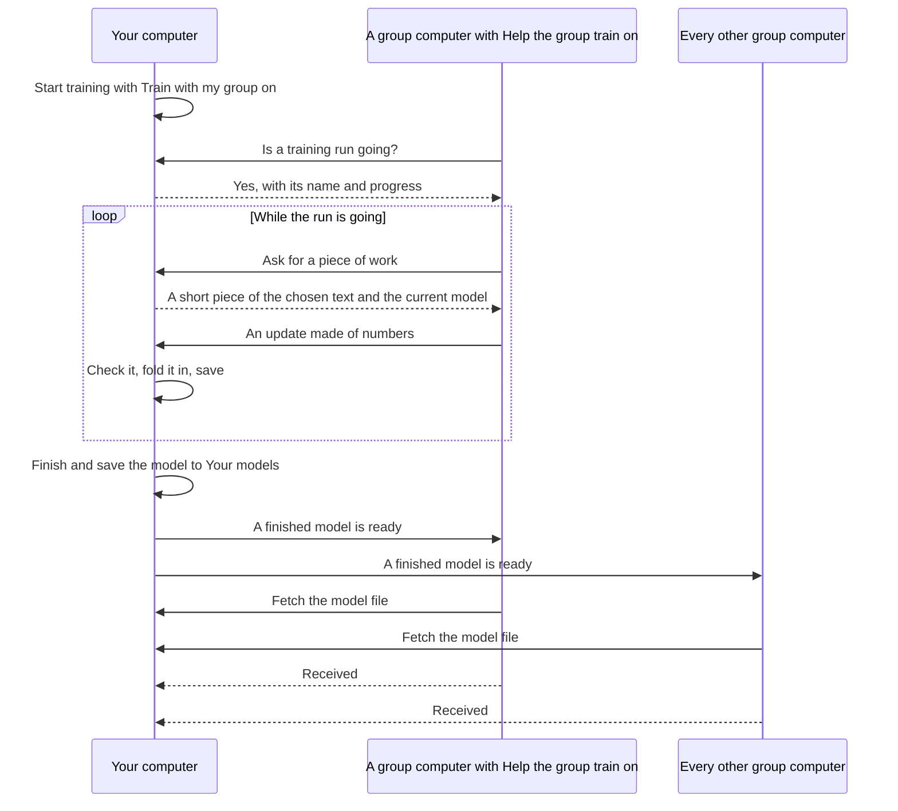

# Train your own small AI, privately, with your group

Sovra can teach a small AI model from text you choose. It runs inside the Sovra
app on your own computer, the computers in your [group](groups.md) can join in,
and every computer in the group receives the finished model. There is no cloud
service, no Python, no separate training program and nothing to download: the
training engine is part of the one Sovra executable on macOS, Windows and Linux.
No chat provider or API key is needed.

What you get is a small model that continues text in the style you taught it.
It does not replace the AI that answers your chats, and it does not change that
AI. See [Limits](#limits) for exactly what is and is not supported.

## Your first run, in five minutes

1. Open **Training** in the sidebar. It is also on **Skills** as
   **Teach your own AI model with your group**, and in the guided tour.
2. Look at the **This computer** card. It shows what this computer has to train
   with, whether training will use its graphics card, and which model sizes it
   is comfortable with.
3. Under **What should it learn?**, leave **Try the sample** selected. The
   built-in garden sample is about 2,000 characters.
4. Leave the suggested **Starting point** and the **How thorough?** choice as
   they are, or pick **Quick try** to finish sooner.
5. If you are in a group, decide about **Train with my group**. Leave it on to
   let the group help and to give everyone the finished model. Turn it off to
   keep this run on this computer. Read [Privacy and consent](#privacy-and-consent)
   before sharing your own text.
6. Press **Start training**.
7. Watch the chart fall and the sample under **What it writes right now**
   change from noise into words. **Pause** and **Resume** continue the same
   run. **Finish now and keep the model** ends the run early; nothing is lost.
8. When the run finishes, the model appears in **Your models**. Press
   **Try it**, type a beginning, and press **Continue this text**.

To teach it your own writing, choose **Use my text** and paste, or
**Use a text file** and pick a file. Text must be 32 bytes to 4 MiB of plain
UTF-8. A file must end in `.txt` or `.md`. Sovra uses only the text you choose
on this page: chats, memories, indexed folders and shared notes are never added.

Training gives way to chat. While Sovra's chat AI is answering, training waits
and carries on afterwards. This is not operating-system idle detection, and
there are no power or temperature budgets.

## Train with your group

Group training needs a group first: [create or join one](groups.md#start-or-join).
Keep Sovra open on the computers taking part.



### On the computer that owns the run

1. Choose the text, starting point and thoroughness as for a run on one computer.
2. Leave **Train with my group** on and press **Start training**. This one
   choice, made for this run, is what allows group computers to receive pieces
   of the chosen text. Nothing else grants it.
3. The **Helpers** tile shows how many computers are helping now and how many
   rounds they have given. Your computer keeps training on its own as well, so
   the run never waits for a helper.
4. **Pause** stops this computer's work and stops giving out work.
   **Carry on without my group** keeps the run going on this computer only.

The **Large** starting point trains on this computer only, because its work
pieces do not fit in one group message, so **Train with my group** is not
offered for it. To give a finished Large model to the group, press
**Share with my group** on it in **Your models**.

### On a computer that helps

1. Open **Groups** and, under **Your choices for this computer**, turn on
   **Help the group train**. It is off until you turn it on, and it stays as
   you left it when Sovra restarts.
2. That is all. When this computer is not training its own model and chat is
   not busy, Sovra looks for a run a group member started with the group and
   helps it. The Training page shows **Helping your group** with who is being
   helped and how many rounds this computer has given.
3. **Stop helping** stops at once and keeps helping off until you restart
   Sovra, or turn **Help the group train** off and on again. Starting your own
   run also ends automatic helping, and your run starts.

A helper works on one piece at a time and sends back only an update made of
numbers. It never sends any of its own text or files, and its own saved run
and models are left as they were. **Advanced** also has **Help one computer
now**, with a **Help now** button beside each group computer; that works
without the switch because choosing the computer is the consent.

### How everyone receives the model

When a run started with **Train with my group** finishes or is stopped, the
owner's computer tells each group computer that a model is ready and keeps
offering it. Each computer then fetches the file itself, checks it, and adds it
to **Your models** marked as coming from that person and computer.

- Receiving does not depend on **Help the group train**. Every current member
  of the group receives finished models.
- A computer that was switched off gets the model later. Each computer asks the
  others for new models when Sovra starts, when the Training page opens, and
  about every 30 seconds for computers it has heard from recently.
- The owner's **Your models** shows **On N of M computers in your group**,
  names the computers it has still to arrive on, and remembers this across
  restarts.
- A received file is kept only if it is the size its description says, its
  content matches its identity exactly, and the training engine accepts it.
  Otherwise the page says a model did not pass its checks and nothing is kept.
- A model is data. Sovra never runs a received model as a program. It is used
  only by **Try it** and as a starting point for more training.
- To give the group a model trained without the group, press
  **Share with my group** on that model. Only the computer that trained a model
  can share it; received models are not passed on automatically.

A slow or missing helper does not hold the run up. If a helper disappears, a
fresh piece is given out and its late answer is refused. An update that does
not match its piece (wrong computer, wrong size, wrong count, or numbers that
are not finite) is refused and the saved model stays as it was.

## Watching it learn

While a run is going, and after it, the page shows a progress bar, a chart,
stat tiles and a sample.

| What you see | What it means in plain words |
| --- | --- |
| **Round** x of y | One round reads a handful of short stretches from different places in the text and folds what was learned into the model. The preset decides how many rounds there are. |
| **Speed** | Letters a second: how many next-letter guesses this computer learns from each second. |
| **Time left** | Worked out from the measured speed, and rounded. It says **Measuring…** until a speed is known. Before you start, each preset shows a rough guess for this computer. |
| **Loss** | How surprised the model is by the text it is learning from. Lower is better. An untrained model starts near 5.5, which is a blind guess among all 256 possible bytes. The page also says it in words, for example "Narrowed each next letter down to about 10 choices." |
| **Check loss** | The same measure on the end of your text, which is kept back and never learned from (10% unless you change it). It shows whether the model has learned the style or only memorised the text. |
| **Helpers** | Group computers helping right now and the rounds they have given, or **This computer only**. |
| **What it writes right now** | A short piece of text the model wrote at the last check, so you can read the improvement. |

The chart draws the **Learning loss** as one line and the **Check loss** as a second. Both
should fall. If the loss keeps falling while the check loss rises, the model is
memorising a small text: stop, or give it more text. The **Thorough** preset
finishes early by itself when the check loss has stopped improving.

Loss is a measure of next-letter guessing on your text. It is not a score of
chat quality. The chart keeps at most 240 points; on a long run it thins out
older points and still spans the whole run. After a restart the chart is
restored with the saved run.

## The This computer card

| Fact | Where it comes from |
| --- | --- |
| **Computer** | The operating system's name and version, and the processor type (for example `x86_64` or `aarch64`) |
| **Processor** | The processor's name |
| **Cores** | Cores and threads, for example "8 cores, 16 threads" |
| **Memory** | Total memory and memory free right now. Free memory is refreshed each time the page opens and when you press **Check again**. |
| **Training engine** | **Graphics card** when Sovra trains on this computer's graphics card, otherwise **Built-in processor engine**. See [Graphics cards](#graphics-cards). |
| **Graphics** | The name of the graphics card in use. The row is absent when the processor does the work. |
| Recommendation | One sentence, for example "This computer is comfortable with Small and Medium models." |

The facts are read on this computer through the operating system. Nothing is
run and nothing is sent anywhere, including to your group. A fact that cannot
be read shows **Not known**, and then only **Starter** and **Small** count as
comfortable. Each starting point is marked as recommended, comfortable or
likely to be slow on this computer.

The suggested starting point favours seeing a result soon: **Small** on most
computers, **Medium** when training uses a graphics card or there are at least
8 processor threads and 8 GiB of memory, and **Starter** on a very small
computer. **Large** is never suggested for a first run: it needs a long run to
beat Medium.

### Graphics cards

Sovra trains on a graphics card when the computer has one that passes three
checks, made once each time Sovra starts, the first time the Training page
needs them:

1. It is a real card. A software renderer that only imitates one is ignored.
2. It gives the same answers as the processor on a small test model.
3. It is clearly faster: at least one and a half times the processor's speed
   on the Small model. A weak card built into a processor can be the slower
   of the two, and then the processor is used.

A separate card is tried first, then one built into the processor. Nothing is
installed or downloaded for this, and there is no setting to turn on: the
graphics engine is part of the same Sovra executable on macOS (Metal), Windows
(DirectX 12 or Vulkan) and Linux (Vulkan), and uses the driver the computer
already has.

On a card, each round reads four times as much text and a preset takes half
as many rounds: twice the reading of a processor run in a fraction of the
time. The **Starter** table always trains on the processor, where it already
takes seconds.

If the card fails during a run (it runs out of memory because another program
is using it, the driver stops, or the card is unplugged), the step that failed
is done again on the processor and the run carries on there. The card is then
left alone until Sovra is restarted. Nothing is lost, but the rest of that run
is slower, because it keeps its graphics-sized rounds.

Results on a card and on a processor agree to several decimal places, not bit
for bit. A run that must repeat exactly should be compared on one engine.

## Starting points

Every starting point is built into Sovra and starts untrained. They read and
write plain bytes, so there is no vocabulary file and any language or alphabet
works. A model can look back only as far as its **reach**.

| Starting point | What it learns | Size | Reach | Model file | Comfortable with | Group can help train it |
| --- | --- | --- | --- | --- | --- | --- |
| **Starter** | Which letters follow which. Learns in seconds. | 65,536 values | 1 byte | 0.25 MiB | Any computer | Yes |
| **Small** | Words and short phrases. A good first real try. | 137,216 values | 64 bytes | 0.5 MiB | 2 threads, 1 GiB | Yes |
| **Medium** | Sentences and style. A group makes it quicker. | 875,520 values | 128 bytes | 3.3 MiB | 4 threads, 2 GiB | Yes |
| **Large** | Longer passages. Slow without a graphics card. | 2,817,280 values | 256 bytes | 10.7 MiB | 8 threads, 4 GiB | No, this computer only |

**Starter** is a table of letter pairs. **Small**, **Medium** and **Large** are
small transformers (the same kind of design as large language models, at a
tiny fraction of the size): 2, 4 and 6 layers, 64, 128 and 192 wide.

Below the built-in sizes, the card lists every model in **Your models**,
including ones you received, each with a **Continue this** button. Training
continues that model with the text you choose and keeps its size. The result
is saved as a new model; the one you started from is not changed.

## How thorough?

Each preset is a complete set of recommended settings, so Advanced never has
to be opened.

| Preset | In one sentence | Starter rounds | Small rounds | Medium rounds | Large rounds |
| --- | --- | --- | --- | --- | --- |
| **Quick try** | A short run to see it learn. | 80 | 600 | 240 | 120 |
| **Balanced** | A good model in a reasonable time. | 400 | 2,000 | 3,200 | 6,000 |
| **Thorough** | The best result. Leave it running, and pause whenever you like. | 2,000 | 10,000 | 12,000 | 20,000 |

These are the rounds on a processor, where a round of a Small, Medium or Large
model reads about 512 bytes. On a [graphics card](#graphics-cards) a round
reads about 2,048 bytes and each preset takes half the rounds shown.

**Starter** uses more rounds when the text is long, so that all of it is read.
**Thorough** finishes early when the check loss has not improved for 400
(Starter), 2,000 (Small), 2,400 (Medium) or 4,000 (Large) rounds, or half
those on a graphics card.

The bigger a model, the more it must read before it is any good. Measured on
a 280 kB text, Small, Medium and Large all sit near a check loss of 2.3 (about
what the Starter table manages) until they have read roughly 1, 1.6 and 3 to 4
million bytes, and then improve quickly. **Balanced** is sized to get each
model past that point, which is why the larger models get more rounds, not
fewer. **Quick try** stops well short of it for Medium and Large: it shows the
run working, not a finished model.

A short text gets fewer rounds than the table says. Reading the same text
over and over only memorises it (on the built-in sample the check loss is
best after 60 to 150 readings and climbs after about 200), so no preset lets
Small, Medium or Large read the text more than 120 times. On the sample that
is 452 rounds on a processor and 113 on a graphics card, whichever preset is
chosen; texts of about 100 kB and more always get the full number.

Measured on one desktop (AMD Ryzen 7 3700X, 8 cores; NVIDIA RTX 2080 Ti),
release build, while the computer was also doing other work. Loss is shown as
loss at the end (check loss).

**Quick try** on the built-in sample:

| Starting point | Processor | Graphics card |
| --- | --- | --- |
| Starter | 0.5 s, 300,000 guesses a second, 1.99 (2.32) | trains on the processor |
| Small | 10 s, 22,000, 1.02 (2.42) | 1.6 s, 163,000, 1.76 (2.23) |
| Medium | 24 s, 5,100, 1.74 (2.29) | 7 s, 50,000, 1.74 (2.15) |
| Large | 34 s, 1,800, 1.96 (2.20) | 10 s, 16,000, 2.00 (2.18) |

**Balanced** on a 280 kB text (this repository's documentation):

| Starting point | Processor | Graphics card | Textbook trainer on the card, same steps |
| --- | --- | --- | --- |
| Starter | not measured | 3 s, 2.60 (2.78), on the processor | does not apply |
| Small | 50 s, 1.73 (1.70) | 10 s, 1.60 (1.61) | 1.67 (1.54) |
| Medium | 6.8 minutes, 1.72 (1.72) | 70 s, 1.28 (1.41) | 1.35 (1.43) |
| Large | not measured; about 25 minutes expected | 6.7 minutes, 1.09 (1.43) | 1.01 (1.43) |

Before these settings, the same Balanced runs on the same text ended at check
losses of 2.15 (Small), 2.41 (Medium) and 2.60 (Large), on either engine.

These are one machine's numbers, not a promise for yours; the page measures
your computer's own speed once a run is going. A development build
(`cargo xtask dev`) trains several times slower than a released build. No
speed-up from adding group computers has been measured yet. To measure your
own computer, see [Measuring it](#measuring-it).

## Advanced reference

**Advanced** is closed by default; **Show advanced settings** opens it.
Changing a setting makes the run a custom one; **Reset to recommended** puts
the preset's settings back. A value outside its
range is refused with a sentence naming the setting, and nothing starts.

Step sizes and other fractions are typed as ordinary decimals, such as 0.003.
The settings are grouped as they are on the page.

**How much training**

| Setting | What it does | Range | Recommended |
| --- | --- | --- | --- |
| Rounds | How many times the model is improved | 20 to 100,000 | From the preset |
| Text per packet | Most bytes of your text handed out in each round. For Small, Medium and Large a packet is short stretches from different places in the text, one for each window when they fit; when they do not, the windows share the stretches that do. | 64 to 4,096, and at least the model's reach plus one | Room for every window: Small 544, Medium 528, Large 520 (four times that on a graphics card); Starter 512 |
| Windows per step | Stretches of text read from the packet in each step | 1 to 64; always 1 for Starter | Small 8, Medium 4, Large 2; on a graphics card 32, 16 and 8 |
| Steps per round | Learning steps taken on a packet before its result is folded in. More than one makes each round cost more without teaching more. | 1 to 16 | 1; Starter 4 |

**Step sizes**

| Setting | What it does | Range | Recommended |
| --- | --- | --- | --- |
| Round step size | How far the model moves each round. This is the step size that matters: lower is steadier, higher is quicker and riskier. | 0.000001 to 1 | Small 0.005, Medium 0.003, Large 0.0015, Starter 0.25 |
| Step size over the run | Whether the round step size stays the same (**Steady**), eases down to a tenth (**Ease down**), or warms up first (**Warm up, then ease down**) | One of the three | Warm up, then ease down; Starter Steady |
| Warm-up rounds | Rounds spent easing the step size up at the start | 0 to the number of rounds | A twentieth of the rounds, at least 5; Starter 0 |
| Learning rate | Step size inside one packet, the same in every round. It mostly sets the direction, so changing it does little. | 0.000001 to 10 | 0.003; Starter 0.1 |
| Steps inside a packet | The rule a computer uses for its learning steps on one packet: **Plain steps (SGD)** or **Adaptive steps (Adam)**. Its memory starts fresh with every packet. With plain steps the round's own Adam sees the whole correction; adaptive steps pass on only its direction, which measured slightly worse. | One of the two | Plain steps (SGD) |
| Weight decay | Gently pulls values towards zero so the model does not just memorise; 0 turns it off | 0 to 1 | 0 |
| Step limit | Largest correction one step may make; 0 means no limit. Each round's folded-in update is always limited as well. | 0 to 1,000 | 1; Starter 0 |

**Checking and sample text**

| Setting | What it does | Range | Recommended |
| --- | --- | --- | --- |
| Check share | Percent of the end of your text kept back to check the model on text it has not learned from; 0 means no check | 0 to 30 | 10; 0 for text under 160 bytes |
| Rounds between checks | Rounds between checks and fresh sample text | 1 to 10,000 | Quick 20, Balanced 50, Thorough 100, or half those on a graphics card; Starter 10, 20, 50 |
| Stop when stalled | Finish early after this many rounds without a better check result; 0 means never | 0 to 100,000 | 0 for Quick and Balanced; see the presets for Thorough |
| Sample variety | How adventurous the sample text is; 0 always picks the likeliest letter | 0 to 5 | 0.8 |
| Sample length | Bytes of sample text written each time | 16 to 512 | 200 |
| Seed | Starting number for the random choices, including which stretches of text each round reads. Keeping it the same makes a run on one computer, without helpers, repeatable on the processor engine; on a graphics card it repeats to several decimal places. | Any whole number from 0 | 42 |

**This computer**

| Setting | What it does | Range | Recommended |
| --- | --- | --- | --- |
| Processor threads | Threads the processor engine uses; 0 lets Sovra decide (up to 4). More rarely helps models this small. It has no effect on work done by a graphics card. | 0 to 64 | 0 |

**Group helpers**

| Setting | What it does | Range | Recommended |
| --- | --- | --- | --- |
| Rounds a helper may lag | A helper's result is turned away once the run has moved this many rounds past where the helper started | 1 to 1,024 | 128 |
| Lag discount | How quickly an older result counts for less, for each round it is behind | 0 to 100 | 0.02 |
| Seconds a helper may keep a packet | How long a helper may hold a packet before it is given to another computer | 5 to 3,600 | 120 |

A **Starter** run on its recommended settings is sent to helpers in the form
that Sovra 0.5.0 understands. Changing its text per packet above 512, its
steps inside a packet, step size over the run, learning rate, weight decay or
step limit moves it to the
newer form, which 0.5.0 helpers cannot read.

## Your models and Try it

**Your models** lists every model on this computer, newest first: its name,
starting point and size, how far it was trained, and where it came from
(**Trained here**, or from a person and computer in your group).

- **Try it:** type a beginning of up to 512 bytes, or nothing, and press
  **Continue this text**. The model continues it with up to 240 bytes. Each try is different, and one try runs
  at a time.
- **Share with my group:** offer a model trained on this computer to your
  current group. See [How everyone receives the model](#how-everyone-receives-the-model).
- **Copy file location:** copy where the model file is on this computer.
- **Continue this** under **Starting point** trains a model further.

There is no delete button. Models are small, and Sovra does not remove work.
The list shows up to 128 models. Models received from the group stop being
fetched at 64 models or 512 MiB; the page then says there is no room, and
nothing is removed to make room. Starting a new run while an earlier one is
unfinished first saves the earlier model to **Your models**.

## Privacy and consent

Training stays on this computer unless you start a run with
**Train with my group** on, or press **Share with my group** on a model.

### What travels, to whom, and when

| What | Goes to | When |
| --- | --- | --- |
| Pieces of your chosen text, up to 4,096 bytes each, with the current model's values and the settings for that piece | Any computer currently in your group that asks to help. In practice these are the computers with **Help the group train** on, or where someone chose to help yours by hand. | Only while a run you started with **Train with my group** is running. Not while paused or finished, not after **Carry on without my group**, and not after Sovra restarts until you start a run with the group again. |
| The run's name, starting point and progress | Any current group member's computer that asks whether a run is going | Under the same conditions |
| An update made of numbers, the same size as the model | From a helper back to the owner | After each piece the helper works on |
| The finished model file and its description: name, your name and computer name as the group knows them, size, rounds, loss values, when it was made, and the group it is shared with | Every computer currently in the group | After a run started with the group finishes or is stopped, or after **Share with my group**, for as long as you stay in that group |
| Hardware facts, the chart, the sample text, your other models, and the text itself as a whole | Nobody | Never sent |

A piece is one unbroken stretch for a Starter run, and several short stretches
from different places in the text for Small and Medium. Over a long run,
helpers are sent effectively all of the text the model learns from, one piece
at a time. The part kept back for the check loss is not sent.
**Use text you are willing for the people in your group to read.**

- **The connection is encrypted, the receiver can read it.** Training traffic
  uses the group's authenticated, encrypted connection between two computers,
  possibly through an encrypted relay (see [Groups: network](groups.md#network)).
  It is not additionally sealed with the group's sharing keys. The helping
  computer necessarily sees the pieces it works on. Sovra does not save those
  pieces to a file on the helper.
- **A model can give away its text.** A small model trained on a small text
  can reproduce parts of it. Everyone who receives the model can try it.
  Updates from helpers can likewise reveal something about the piece they came
  from.
- **Membership alone grants nothing.** Joining a group, answering group
  questions and lending an AI do not start training, send text or make this
  computer help. The owner's side needs an explicit start with the group for
  each run; that grant is kept in memory only and is never saved. The helper's
  side needs **Help the group train** on, or an explicit choice of computer.
- **Only group members.** Every training request is checked against the
  current member list on both computers, before sending and again before
  answering. A computer that is not in the group, or that names another group,
  is refused before any training code runs. Someone who has been removed gets
  nothing further.
- **Nothing is taken back.** Pausing, **Carry on without my group**, leaving the group or
  removing a member stops what happens next. It cannot recall text, updates or
  models a computer has already received.
- **A piece of work is data, not instructions.** It carries text, numbers and
  a fixed set of bounded settings. It cannot name a file, a command, a program
  or a download. Each piece is tied to the one computer it was given to.
- **The name shown on a received model comes from your own member list**, not
  from what the sending computer says about itself.

### Where files live

Everything is under `training/` in the
[app data directory](configuration.md#data-location). On macOS and Linux the
files are readable only by your user account. They are written through a
temporary file and a rename, so a crash leaves the previous file intact.

| File | Contents |
| --- | --- |
| `run-<id>.train` | One run: **the full chosen text**, the model, the optimizer's state and the settings. Small is about 2.7 MB, Medium 17.5 MB, Large 56 MB, plus the text. |
| `run-<id>.notes.json` | That run's chart history, sample, and whether it was stopped and saved to Your models |
| `latest.json` | The name of the most recent run |
| `models/<id>.model` | One model: a 64-byte description followed by the values. It does not contain the training text. The file name is the fingerprint of its content, so every copy in the group is provably the same file. |
| `models/<id>.json` | That model's name, origin, group, and which computers have received it |
| `owner.lock` | Stops a second Sovra window from using the same folder |

A run is saved when it is paused, stopped, finished and when Sovra closes, and
every few seconds to a minute while it runs, depending on how long a save takes.
A crash therefore loses at most that much training. While helpers are joined it
is also saved before each piece of work leaves and before each update is
acknowledged. Closing Sovra leaves an unfinished run paused; reopening never
starts training by itself. Runs saved by Sovra 0.5.0 (`run-<id>.json`) still
open, as a **Starter** run.

Keep backups private: run files contain your text and are not encrypted by
Sovra. Close Sovra before copying the folder. Sovra never deletes anything in
it; remove files yourself, with Sovra closed, if you need the space.

## One executable, every operating system

The training engine is the Rust library [Burn](https://burn.dev), compiled
into the Sovra executable with its pure-Rust processor backend and its
graphics backend (wgpu). The same released executable for macOS, Windows and
Linux contains everything on this page, and decides for itself whether this
computer's [graphics card](#graphics-cards) is worth using.

- No Python, no separate trainer process, no container, no cluster software.
- No model, vocabulary or other download. The starting points are built in and
  start untrained.
- No system library beyond what Sovra already needs to draw its window. The
  graphics engine talks to the card through the graphics driver the computer
  already has; no CUDA or other toolkit is installed.
- Hardware facts come from the operating system through a Rust library; no
  external tool is run.

Released builds are made for macOS on Apple Silicon, Windows x64 and Linux x64;
see [Releasing](releasing.md).

## Measuring it

Training is measured with one tool, kept beside the engine. It runs real
training runs through the same engine and the same recommended settings as the
app, so its numbers include the checks and sample text a real run writes:

```sh
cargo run --release -p sovra-train --features gpu --example training_benchmark -- --help
```

| To measure | Add |
| --- | --- |
| The Quick try of every starting point on the built-in sample | nothing |
| Another preset, or only some starting points | `--preset balanced`, `--models small,medium` |
| Your own text | `--text notes.txt` |
| The processor only, even with a graphics card | `--engine processor` |
| One changed setting | `--set rounds=500`, `--set windows=16` (may be repeated) |
| The same model trained the textbook way, for comparison | `--textbook yes` |

Leave out `--features gpu` to build the processor engine alone. Always pass
`--release`: a development build trains several times slower. For each
starting point the table shows the rounds, the first round (which includes
opening the graphics card), the fastest and the median round, the whole run,
next-letter guesses a second, and the loss and check loss at the end.

`--textbook yes` follows each Small, Medium or Large run with a reference
trainer: one model, one AdamW optimiser kept for the whole run, windows drawn
from anywhere in the text, for the same number of steps and windows. It shares
the model code and the check with real runs, so a gap between the two rows
comes only from how a run is organised.

## Troubleshooting

| What you see | What to do |
| --- | --- |
| "Use between 32 bytes and 4 MB of text for training." | The text is too short, too long or blank. A file larger than 4 MiB is refused without being loaded. |
| "Choose a plain text file ending in .txt or .md." or "That file is not plain text…" | Save the document as plain UTF-8 text first. Word, PDF and other formats are not read here. |
| A sentence such as "Rounds must be between 20 and 100,000." | An Advanced value is out of range. Fix it or press **Reset to recommended**. |
| "Create or join a group first." | **Train with my group** and **Share with my group** need a group. Open **Groups**. |
| **Train with my group** is not offered for **Large** | Large trains on this computer only. Press **Share with my group** on the finished model to give it to everyone. |
| No helpers join | Check that the other computer is in the same group, is running Sovra, has **Help the group train** on, is not training its own model, is not in the middle of a chat answer, and did not press **Stop helping** since it started. Your run must be running, not paused. A computer on Sovra 0.5.0 can help only a Starter run on recommended settings. |
| "This computer is helping your group train. Stop helping before starting your own training." | This computer was told to help one computer with **Help now**. Press **Stop helping**. Automatic helping gives way by itself. |
| "Helping is off until you restart Sovra, or turn Help the group train off and on again in Groups." | You pressed **Stop helping**. Do one of the two to help again. |
| A group member has not received the model | Their computer must be on, running this version of Sovra and still in the group. Opening **Training** on it asks straight away. |
| "A model offered by … did not pass its checks, so it was not kept." | The file that arrived was not what its description said. Sovra waits and tries again later. |
| "Your models has no room for more models from your group…" | The limit for received models is reached. Nothing is removed automatically. |
| "Training storage is unavailable or open in another Sovra window." | Close the other window and restart this one. Only one window can use the training folder. |
| "The saved training file is damaged or from an unsupported version. Your file has been kept." | The last run could not be opened. Start a new run; the old file stays in the folder. |
| "Training finished early because the check stopped improving." | **Stop when stalled** ended the run. The model is in **Your models**. |
| "Training stopped before its first round, so there is no model to keep yet." | The run was stopped before it learned anything. Start again. |
| It is slow | Choose a smaller starting point or **Quick try**. Large is slow without a graphics card. Development builds are several times slower than released ones. |
| **Training engine** says **Built-in processor engine** on a computer with a graphics card | The card did not pass its checks: it was not found, gave different answers from the processor, or was not clearly faster. See [Graphics cards](#graphics-cards). Updating the graphics driver and restarting Sovra makes it check again. |
| Training became slower part-way through a run | The graphics card failed, most often because another program filled its memory, and the run carried on with the processor. Restart Sovra to use the card again; **Pause**, restart and **Resume** continue the same run. |

## Limits

- **Small, byte-level models only.** The four built-in starting points are the
  whole range: at most about 2.8 million values and a reach of 256 bytes. They
  continue text in the style they were taught. They do not chat, follow
  instructions or answer questions, and they cannot be selected as a chat AI.
- **No pretrained models.** Importing or fine-tuning an existing language
  model, and tokenizer files, are not supported. Models cannot be exported to
  other tools' formats.
- **One graphics card, chosen for you.** Sovra uses the first separate card,
  or else the one built into the processor, and only when it passes its
  checks. There is no setting to pick a card or to keep training off the
  card, several cards are not used together, and the card's free memory is not
  measured beforehand: a run that does not fit carries on with the processor.
  Measured on one card only (an NVIDIA RTX 2080 Ti on Linux); Metal and
  DirectX have not been measured.
- **Large is not trained with the group.** The group helps with Starter, Small
  and Medium, whose work fits in one group message. A Large model reaches the
  group only through **Share with my group**.
- **One text, one run at a time.** A run learns from one pasted text or one
  `.txt`/`.md` file of up to 4 MiB. There is no folder import and no picker
  for older unfinished runs.
- **One group, one run to help.** A helper joins the first shared run it finds
  and stays with it until that run ends. There is no balancing between several
  runs.
- **No measured group speed-up yet**, and no test across separate machines on
  different networks. Tests run several complete Sovra runtimes in one process.
- **Mixed versions.** Sovra 0.5.0 computers cannot receive models and can help
  only a Starter run on recommended settings.
- **No formal privacy protection.** Noise-based privacy and secure aggregation
  exist as library code and are not applied to this training; see
  [Swarm internals](swarm.md#integration-and-security-limits).
- **No resource budgets.** Training yields to chat but has no power,
  temperature or operating-system idle detection.

## Implementation map

| Part | Source |
| --- | --- |
| Plans, presets, settings and their ranges | [plan.rs](../crates/sovra-core/src/training/plan.rs) |
| Starting points, model shape and the model file | [models.rs](../crates/sovra-core/src/training/models.rs) |
| Chart history, loss wording and time left | [metrics.rs](../crates/sovra-core/src/training/metrics.rs) |
| Hardware facts and recommendations | [core hardware.rs](../crates/sovra-core/src/training/hardware.rs), [engine probe](../crates/sovra-train/src/hardware.rs) |
| Choosing and checking the graphics card | [device.rs](../crates/sovra-train/src/device.rs) |
| Measuring training | [training_benchmark.rs](../crates/sovra-train/examples/training_benchmark.rs), [reference.rs](../crates/sovra-train/src/reference.rs) |
| Model library and delivery rules | [library.rs](../crates/sovra-core/src/training/library.rs), [delivery.rs](../crates/sovra-core/src/training/delivery.rs) |
| Group messages and work pieces | [work.rs](../crates/sovra-core/src/training/work.rs) |
| Commands, page state and engine ports | [training.rs](../crates/sovra-core/src/training.rs) |
| Running, saving, helping and delivering | [runtime training](../crates/sovra-runtime/src/training.rs) and [its modules](../crates/sovra-runtime/src/training) |
| The Burn engine | [sovra-train](../crates/sovra-train/src/lib.rs) |
| The page | [training_view.rs](../crates/sovra-ui/src/training_view.rs) |

For work leases, merge rules, file formats and tests, see
[Swarm internals](swarm.md). For other network traffic, see
[Network access](network.md).
