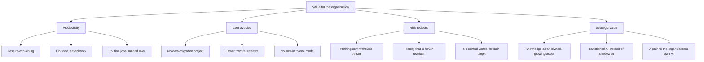

# Value drivers

Where Sovra creates value for an enterprise, which capability drives each
part, and how each part is measured. Every row is a **hypothesis to test** in
a pilot ([06 — Measuring value](06-measuring-value.md)), not a promised
number.

## The value tree

## 1. Productivity

| Driver | Capability today | Evidence | Leading indicator | Lagging indicator |
| --- | --- | --- | --- | --- |
| **Less re-explaining** | Memory captured from private chats, each detail quoting the exact words it came from, recalled within a two-second budget. | `docs/memory-capture-and-recall.md`; `crates/sovra-runtime/src/recalling.rs` | Details learned and corrected per week | Minutes per routine task |
| **Finished, saved work** | A team of 12 helpers; Save on every reply and code block; 9 kinds of saved work with versions. | `crates/sovra-core/src/teams.rs`; `crates/sovra-core/src/artifacts.rs` | Saved artifacts per person | Time to finish a document |
| **Work grounded in the organisation's files** | Folders read where they are, watched for changes, fully re-checked every 15 minutes. | `docs/skills-and-file-knowledge.md` | Folders connected; links approved | Time to find an answer in the files |
| **Routine jobs handed over** | Schedules: daily, weekdays, weekly, every N hours or once; timed messages with consent given when the job is created. | `crates/sovra-core/src/schedules.rs`; `docs/communications.md` | Active schedules | Hours of routine work removed |
| **No learning curve** | 49 built-in skills with **Try an example**; plain words. | `crates/sovra-core/src/skills/builtin.rs` | Skills tried in week 1 | Share of staff active in week 4 |

Why this addresses the main cause of failed AI pilots: the MIT study in
[09](09-sources.md) names a **learning gap** — tools that do not remember and
do not fit the work. Memory with sources and files read in place are aimed
directly at that gap.

## 2. Cost avoided

| Driver | Why it exists | Measure |
| --- | --- | --- |
| **No data-migration project** | Files are read in place; nothing is uploaded to a vendor store before value starts. | Days from install to first real workflow |
| **Fewer transfer and vendor reviews** | With a local model, the work never leaves the computer, so there is no cross-border transfer and often no new processor to assess ([07](07-regulated-and-sovereign-markets.md)). | Data-transfer or vendor reviews avoided |
| **No lock-in to one model** | The model is a replaceable guest: local servers, OpenRouter, Anthropic or any compatible API. Memory, files and helpers stay when the model changes. | Cost of switching model (configuration only) |
| **Existing hardware** | Runs on the computers staff already have; idle machines doing work for busy ones is **Next** ([05](05-enterprise-vision.md)). | Hardware bought for the pilot (target: none) |

Sovra does not publish a price or a total-cost comparison in this folder.
Any cost model must be built from the customer's own numbers.

## 3. Risk reduced

| Driver | Capability today | Evidence |
| --- | --- | --- |
| **Nothing sent without a person** | Messages are prepared as review cards; no model tool can approve or edit them; ten-minute deadline; no automatic retry. Gmail is drafts only; Calendar invites nobody; Drive is read-only. | `docs/communications.md`; `docs/google.md` |
| **Nothing run without a person** | Terminal commands show Allow once / Always / Don't allow; risky forms are asked every time and never remembered. | `docs/terminal.md` |
| **Outsiders get nothing** | Strangers who message the bot get no memory, files, skills, connected services or tools, and their messages are not remembered. | `docs/communications.md` |
| **Knowledge cannot be quietly corrupted** | Facts must quote their source exactly or the batch is rejected; corrections supersede; nothing is deleted; any fact or source can be stopped. | `docs/memory-capture-and-recall.md`; `crates/sovra-core/src/memory.rs` |
| **Suggested links need a person** | Only the person's **Save** approves an AI-proposed link; confidence is shown as an uncalibrated model estimate. | `crates/sovra-ui/src/knowledge_review.rs` |
| **No central breach target** | There is no Sovra server holding customer data. | [03](03-sovereignty-evidence.md) |

## 4. Strategic value

- **Knowledge becomes an owned, compounding asset.** Each correction improves
  what the helpers know, on the organisation's computers, with a full history.
  Rented AI has to be taught again and keeps what it learns elsewhere.
- **Shadow AI becomes sanctioned AI.** The MIT study found workers at over
  90% of firms use AI tools while only 40% of firms bought one. A sanctioned
  tool that keeps data at home is the alternative to banning what staff
  already do.
- **A path to the organisation's own AI.** Today the model is a guest; in the
  direction ([05](05-enterprise-vision.md), stage 3) the organisation can train
  its own adapters on its own computers, with lineage and rollback.
- **Readiness for AI-native operations.** Governments and enterprises planning
  for a large share of work to be done by AI that acts (see the UAE plans in
  [07](07-regulated-and-sovereign-markets.md)) need oversight and history
  built in, not added later.

## What value is not claimed

- No return-on-investment figure, market size or revenue.
- No accuracy guarantee: the memory evaluations in `docs/evaluations/` used
  synthetic data and the documents themselves say they are not benchmarks.
- No claim that cloud models keep data at home: when a person chooses a cloud
  model, their prompts and the recalled context go to that provider
  ([03](03-sovereignty-evidence.md)).
