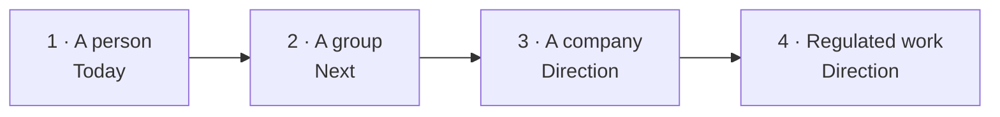

# The enterprise vision

How Sovra grows from one person's computer to a sovereign organisation, what
each stage adds to sovereignty, and what value it is meant to unlock. This is
an enterprise reading of [`docs/roadmap/`](../roadmap/README.md); the roadmap
documents are the authority and win any disagreement.

> Stage 1 and the [group foundation](../groups.md) are implemented. Stage 2
> below describes the fuller **Next** design, including private lanes and work
> handoff. Stages 3 and 4 are **the direction, not today**.

## One idea that carries every stage

Sovra's memory is **append-only and bi-temporal**. Each fact carries when it
was created, when it became true, when it stopped being true and when it was
retired; a correction **supersedes** an old fact instead of overwriting it
(`crates/sovra-core/src/memory.rs`). That one shape is what lets the product
grow without a central database
([roadmap README, "One idea runs through all four stages"](../roadmap/README.md)):

| Step | What the same data shape becomes |
| --- | --- |
| Person → group | A grow-only set of signed records that copies between computers without a server and "converges by construction". |
| Group → company | The same signed records in per-lane Merkle logs with signed checkpoints: a tamper-evident **ledger without a coin**. |
| Company → regulated | A history that is never rewritten, close to what auditors already ask for, with erasable payloads under permanent hashes. |

For an enterprise this matters because **the audit trail is not a bolt-on**. The
thing that makes memory correctable today is the thing that makes it
auditable later.

## The four stages

### Stage 1 — A person (Today)

**What it is.** A native app on macOS, Windows or Linux. A team of 12 helpers
and 49 skills, memory with sources and history on the computer, files read in
place, approval before anything is sent or run, any model local or cloud
([`01-a-person.md`](../roadmap/01-a-person.md) §1).

**Sovereignty today.** Data, knowledge, decisions and, with a local model,
the AI itself stay on the computer. See
[02 — Sovereignty model](02-sovereignty-model.md).

**Value today.** Individual productivity with nothing leaving the
organisation: finished, saved work; less re-explaining; routine jobs handed
to schedules; no data-migration project. See
[04 — Value drivers](04-value-drivers.md).

**Honest gaps** (§2): no self-update; signing only when CI secrets exist;
meaning search uses a remote embedding endpoint unless a local one is set;
schedules are not yet persisted across restarts; Google verification pending.

**Groundwork already planned (P1–P7).** Device identity in the keychain, stable
ids, ownership and **lanes** enforced inside the database query, a hybrid
clock, persisted schedules, a local operation log, signed in-app updates and a
bundled local embedding model. Each one "improves the single-laptop product
too": backups, exports, cleaner corrections and multiple profiles.

### Stage 2 — A group of people and their computers (Next)

**What it adds.** A small private group — a family, a firm, a department team —
whose computers share helpers and memory **with no central server**
([`02-a-team.md`](../roadmap/02-a-team.md) §0–1). Computers reach each other
directly by public key, with encrypted relays only as a fallback.

**Sovereignty mechanisms.**

- **Signed membership log** with a two-admin rule and strong removal (§6.2).
- **Pairing** by QR or link, or a short code with an emoji check in the same
  room (§7).
- **Lanes as encrypted spaces** — only me, the group, or two people. The group
  key rotates when someone is removed (§9.2).
- **Filter before retrieval**: a person's private facts are never retrievable
  by another person's helpers; vectors from other people are never accepted
  (§9.5).
- **Signed helper bundles** that only *request* tools; each person grants
  them on their own computer (§10).
- **Work handoff**: a busy laptop sends the whole request to a free computer,
  which runs it on its own local model; no tools or code run for a remote job
  (§11).
- **Relays are blind** and a group can run its own (§8, decision D4).

**Value it unlocks.** Knowledge taught once is used by the group's helpers when
shared; one helper built once and switched on by each person; idle hardware
answers for slow laptops; continuity when someone is away or leaves.

**Acceptance tests worth quoting.** Pairing by link across networks in under
30 seconds; removal reaching online computers within 10 seconds; a private
fact "never retrievable" by another person (§15, T1–T2).

**Explicit non-goals.** Any central Sovra database or any account with
Sovra-the-company; real-time co-editing; groups over about 50 computers.

### Stage 3 — A company (the direction, not today)

**What it adds** ([`03-a-company.md`](../roadmap/03-a-company.md)):

- **Managed identity**: single sign-on and directory sync; device keys in
  secure hardware; enrolment through the organisation's device management.
  Directory groups become lanes; IT signs policy (allowed models, cloud per
  lane, retention, export).
- **Ledger memory**: one Merkle log per lane, signed checkpoints co-signed by
  witnesses, a company root log every node verifies. Payloads can be purged
  while the hash stays, reconciling "never rewritten" with erasure.
- **Company search**: a question fans out only to computers the asker is
  cleared for; results are filtered by the asker's permissions and the query
  itself is logged.
- **Data residency**: placement rules such as "this department's data stays
  on in-country computers", enforced by replication and logged, so a
  **residency report is generated from the ledger itself** (§5).
- **A company model, only if needed**: federated evaluation first; then
  training small adapters on the organisation's own idle computers, combining
  only the lessons with secure aggregation and differential privacy; every
  promoted model is a signed ledger entry with one-step rollback — **model
  lineage** (§6).
- **Audit export** to the organisation's security tools (OCSF to Splunk,
  Sentinel or Elastic).

**Value it unlocks.** Organisation-wide memory and search without a central
data lake; residency evidence on demand; the organisation's own AI that learns
its work without sending a single original file away; one audit trail for
people and AI.

**Risks the roadmap names.** Always-on site nodes are "a server product, and
it changes how Sovra is sold"; weak privacy guarantees at small scale; erasure
under GDPR-style laws; search that "can feel like surveillance"; and the open
question of whether a company model is needed at all.

### Stage 4 — Regulated work (the direction, not today)

**What it adds** ([`04-regulated-work.md`](../roadmap/04-regulated-work.md)):
the controls regulated buyers must have, shipped *inside the product* because
there is no vendor cloud to provide them — encryption at rest by default,
single sign-on and multi-factor sign-in, a per-user audit log, retention and
legal hold, data-subject requests, a per-lane cloud kill switch, a
no-telemetry mode with an offline licence, supervision queues, an agent action
log and ethical walls.

**Supply chain and air-gapped edition.** Signed updates that can be mirrored to
an internal server or USB, signed model bundles, a software bill of materials,
reproducible builds and a separate air-gapped edition.

**Certifications, in order.** SOC 2 Type II → ISO 27001:2022 → ISO 42001:2023
→ sector-specific as needed.

**Risk the roadmap names.** Regulated buyers buy evidence: 12–24 months of
non-feature work. See [07 — Regulated and sovereign markets](07-regulated-and-sovereign-markets.md).

## The principles, in enterprise terms

From the [roadmap principles](../roadmap/README.md):

| Principle | What it means for an enterprise buyer |
| --- | --- |
| Local first, server optional | A server may add availability, relaying or backup — **never authority**. No stage needs a central database. |
| The person stays in charge | Nothing is sent, run or shared without a visible decision that can be revoked. |
| Default private | Sharing is an explicit copy into a lane, never a move, never automatic. |
| Filter before retrieval | Permissions are enforced in the index and query, not by asking a model not to mention something. |
| Other people's words are data | Memory, helpers or skills from someone else never grant tools by themselves. |
| Honest about limits | Limits are shown in plain words (for example, people you remove keep what they already had). |
| Decide in core | Every rule is a pure, tested function; every library sits behind a replaceable port. |
| Plain words | Every capability has a plain-language card on the Skills page. |

## Value by stage, at a glance

| Stage | Status | Sovereignty added | Value unlocked |
| --- | --- | --- | --- |
| 1 · Person | Today | Data, knowledge, decisions on the device; model chosen by you | Individual productivity, no migration project, no transfer review for local work |
| 2 · Group | Next | Encrypted lanes, signed membership, no central server | Shared knowledge and helpers; idle hardware put to work; continuity |
| 3 · Company | Direction | Ledger memory, residency reports, managed identity, model lineage | Organisation-wide memory and search; residency evidence; the organisation's own AI |
| 4 · Regulated | Direction | Encryption at rest, audit log, legal hold, air-gapped edition, certifications | Entry to health, law, finance and government work where data must not leave |
