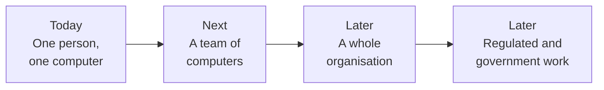

# Investor brief: an AI-native UAE that stays sovereign

A plain-language brief for presenting Sovra to investors who are not
technical. It explains the opportunity, why sovereignty is the heart of it,
what already exists, and where it goes. Use it to understand the story in
depth, then present it in your own words. A suggested talk track and answers
to likely questions are at the end.

> **How to read the labels.** **Today** means it works in the product now.
> **Next** means it is designed and is the next thing to build. **Later**
> means it is the long-term direction and will change as we learn. Never
> present Next or Later as if it exists today.

---

## 1. The story in one minute

The UAE has decided to become **AI-native**: a country where AI does a large
part of everyday work in government and business. That is a huge change, and
it raises a question nobody can ignore:

**If AI does half the work, whose AI is it?**

Today most AI is rented from a few large companies abroad. The work, and
everything the AI learns about that work, goes to their computers. That is
fast to start, but the country ends up AI-native **on someone else's terms**.

**Sovra is the other way.** It gives every person a team of AI helpers that
lives on computers the organisation already owns. The information stays there.
What the AI learns stays there. Nothing is sent or done without a person
saying yes. And the AI "brain" itself can be swapped for a UAE-built one.

In one sentence:

> **Sovra lets the UAE become AI-native without giving away its data, its
> knowledge or its decisions — and proves the value as it goes.**

---

## 2. The moment: the UAE has chosen to be AI-native

These are public facts, with sources in [09 — Sources](09-sources.md).

- **A national goal since 2017.** The UAE appointed the world's first Minister
  of State for AI, and its National Strategy for AI 2031 aims for world
  leadership in AI.
- **Abu Dhabi wants to be first.** Its digital strategy aims to make it the
  world's first fully **AI-native government by 2027**, backed by AED 13
  billion.
- **Half of government on AI.** In April 2026 the federal Cabinet approved a
  plan to run **half of government services and work on AI that acts**,
  within two years, and to train all federal employees in AI.
- **Leaders already appointed.** Dubai requires a **Chief AI Officer** in its
  government entities; 22 have been appointed.
- **People already use it.** In early 2026 about **70% of working-age people
  in the UAE used AI** — first in the world, against about 18% globally.
- **The rules point the same way.** UAE law says **health data must stay in
  the country**. The UAE's AI Charter puts **human oversight** first.
- **The UAE builds its own AI.** Jais, Falcon Arabic and K2 Think are
  UAE-built AI models that anyone may run on their own computers.

**What this means for an investor:** the decision to become AI-native is
already made, funded and staffed. The open question is *how* — and whether
the result is sovereign. That is where Sovra sits.

---

## 3. The problem: five things a country can lose

When an organisation rents its AI, five things can quietly leave its control.
Explain them with everyday examples.

| What can be lost | Plain example | Why it matters |
| --- | --- | --- |
| **1. The data** | A hospital assistant pastes a patient letter into a foreign chatbot. | The file is now on someone else's computer, possibly abroad. For health data, UAE law says that should not happen. |
| **2. The knowledge** | A ministry's best case officer retires. Everything she taught the AI is held by an outside company, or forgotten. | Knowledge is an organisation's most valuable asset. Renting AI means renting it back. |
| **3. The AI itself** | The provider changes its prices, rules or availability. | If you cannot switch, you are dependent. A country should not depend on one foreign supplier for half its work. |
| **4. The decisions** | An AI sends a message to a citizen that nobody checked. | Trust in government depends on a person being accountable. |
| **5. The learning** | Your daily work helps train someone else's AI. | The value created by your people flows to another company, and you cannot see or undo it. |

There is a sixth problem, about money: **most AI projects never pay back.**
A 2025 MIT study found that 95% of organisations it looked at saw no
measurable return from their AI spending. The main reason was not the
technology. It was that the tools **did not remember** and **did not fit the
way people actually work**.

So the opportunity is not simply "AI". It is **AI that the country owns, that
remembers, and that proves its value**.

---

## 4. What Sovra is, in plain words

**A comparison that works for any audience:**

> Rented AI is like a **brilliant consultant who works from their own office
> abroad**. You send them your files. They keep notes you never see. Every
> time you call, you explain everything again. And you cannot stop them
> learning from your work.
>
> Sovra is like **hiring a team of assistants who sit in your own office**.
> Your files never leave the building. They keep notes in your own filing
> cabinet, which you can open and correct. They remember what you told them
> last week. They draft letters, but **you** sign and send them. And if a
> better assistant comes along, you can swap them in without losing a single
> note.

What a person actually sees **today**:

- **A team of AI helpers** on their own computer — a researcher, an editor,
  an organiser and others — that work together in one conversation.
- **49 ready-made skills** written in plain words, each with a "Try an
  example" button. No commands to learn.
- **Memory you can open.** Every detail the helpers remember shows exactly
  where it came from. A correction replaces it, and the old version is kept
  as history, so nothing is quietly rewritten.
- **Your files, understood where they are.** Folders are read on the
  computer; nothing is uploaded first.
- **Finished work you keep.** Letters, tables, briefs and code are saved
  with every version.
- **A person approves everything that leaves.** Messages are prepared and
  wait for a person to press Send. Emails become drafts. Before the AI
  changes anything on the computer, it asks.
- **Any AI brain.** The AI can run on the same computer, or the organisation
  can choose a cloud. It can be a UAE-built model run on its own machines.

---

## 5. Sovereignty, explained simply

This is the heart of the investment case. Use the **"five things that stay
yours"** framing; it maps directly onto the five problems above.

| What stays yours | Where Sovra is | How to say it |
| --- | --- | --- |
| **Data** | **Today** | "Your files and records stay on your own computers. Sovra the company never receives them." |
| **Knowledge** | **Today** on each computer and explicitly shared group details · **Next** private lanes | "What the AI learns is kept in your building, with a receipt for every detail, and you can correct it." |
| **The AI itself** | **Today**, by your choice | "The AI brain is a guest. Run it on your own machines — even a UAE-built one — and swap it any time." |
| **Decisions** | **Today** | "The AI prepares; a person approves. That is the UAE AI Charter's human oversight, built into the product." |
| **Learning** | **Later** | "Your work never trains someone else's AI. Later, your organisation trains its own AI on its own computers." |

### Three things that make Sovra's sovereignty real, not a slogan

1. **There is no Sovra server holding customer data.** It is not a setting
   that could be changed later; the product is designed around having no
   central database. Even the future team version is designed with *no
   central Sovra server* and *no account with Sovra the company*.
2. **Nothing is reported back to Sovra.** There is no usage tracking in the
   product. Sovra does not watch what people do.
3. **It can run cut off from outside services.** With an AI model on the
   organisation's own computers, and the optional web search and outside
   connections switched off, all the work stays inside. (This takes a few
   settings today; it is not yet the default — see section 9.)

### Why sovereignty creates value, not just safety

Investors sometimes hear "sovereignty" as a cost: something you pay for to
stay safe. In Sovra it is the opposite.

- **It unlocks the work that matters most.** Health, justice, finance and
  government are exactly the areas where data must not leave. Rented AI
  struggles there. Sovra is built for it.
- **It removes the slowest step in every AI project.** Projects stall at
  security and legal review. When the data never leaves the building, there
  is much less to review.
- **It turns knowledge into an asset the organisation owns.** Every
  correction makes the helpers better — and that improvement stays with the
  customer, building up year after year. That is a reason to stay that
  renting AI does not have.
- **It keeps options open.** When a better or cheaper AI model appears,
  including a UAE-built one, the organisation switches without losing
  anything.

---

## 6. Value realisation: proving it pays off

Most AI is sold on promises. Sovra is sold on **measured results**.

**The approach, in plain words:**

1. **Pick three real tasks** for a few named people — for example, preparing
   a briefing, answering a common request, writing a standard letter.
2. **Measure how long they take today**, before anything is installed.
3. **Agree in writing** what counts as success, and what means "stop".
4. **Run a short pilot**, for example six weeks, on computers the
   organisation already owns.
5. **Look every week** at simple signs on the computer itself: work saved,
   details the helpers learned, jobs handed over, messages approved.
6. **Decide on a fixed date**: grow, change, or stop.

**Why this matters to an investor:** it shortens the path from first meeting
to a real decision, it builds trust with careful buyers like governments, and
every successful pilot produces the customer's own numbers — the strongest
possible reference.

**What value looks like in practice** (to be measured, not promised):

- Less time explaining the same things again and again.
- Letters, briefs and tables finished, not just suggested.
- Routine weekly jobs handed to the helpers.
- No message or change going out without a person.
- Work that never needs a data-transfer review, because it never left.

The full method is in [06 — Measuring value](06-measuring-value.md).

---

## 7. What already exists

Present these as facts; they are true today.

- **A real, installed program**, not a website — for Windows, Mac and Linux,
  built from one codebase.
- **A team of 12 AI helpers** (eight ready to go, four to add), with
  **23 specialist roles** and **49 ready-made skills**.
- **9 kinds of saved work** — documents, tables, code, diagrams and more —
  all with versions.
- **Memory with receipts**, corrections that keep history, and files read
  where they live.
- **Connections to where people already work**: WhatsApp, Telegram, Gmail
  (drafts only), Calendar, Drive (read only), and more — each one waiting
  for a person to approve.
- **Dependable by design**: no Sovra server holding customer data, no usage
  tracking, and every action that leaves the computer waits for a person.

---

## 8. The path: from one desk to a sovereign nation

| Stage | Status | What it means in plain words |
| --- | --- | --- |
| **One person** | **Today** | A private team of AI helpers on one computer that remembers that person's work. |
| **A group** | Foundation today; full design **Next** | A few computers in an office or family share helpers and knowledge, only when people choose to. A busy laptop can ask a free computer nearby to do heavy work. No central Sovra server. |
| **An organisation** | **Later** | Each department's knowledge kept on its own computers, with a record that cannot be secretly changed. The organisation can show **where its data lives**, and can **train its own AI** on its own computers, with every lesson visible and reversible. |
| **Regulated and government work** | **Later** | The controls that hospitals, courts, banks and ministries require: locked-down storage, full records of what the AI did, a version for networks cut off from the internet, and formal security certificates. |

The [group foundation](../groups.md) already supports membership, peer sync and
explicitly shared text. Helper bundles, private encrypted lanes and work handoff
in this vision remain planned.

**The key insight for investors:** the way Sovra stores memory today —
nothing ever secretly rewritten, every change kept as history — is the same
foundation needed for the organisation-wide record later. The future is
built on what already exists, not on a rewrite.

---

## 9. Honest limits (say these out loud)

Careful buyers, especially governments, trust companies that are open about
limits. Investors do too.

- **The app is in English today.** There are no Arabic screens yet. People
  can write to the AI in Arabic if the chosen AI model handles it.
- **No Arabic AI comes built in.** UAE-built models can be used, but we have
  not yet tested them inside Sovra.
- **Fully local is not the default.** Out of the box, setup suggests a cloud
  AI service and web search is switched on. Keeping everything inside takes
  a few settings changes.
- **The team version is next, not today.** Each computer works on its own
  for now.
- **Training your own AI is later**, and will only be built if testing shows
  it is worth it.
- **No security certificates yet** (such as ISO 27001), and the app cannot
  update itself yet.

The full list, with answers, is in
[08 — Limits and objections](08-limits-and-objections.md).

---

## 10. Why Sovra can win

- **Timing.** The UAE has committed to AI-native government on a two-year
  clock, with officials named and budgets set.
- **The right answer to the right question.** As AI takes on more of the
  work, "whose AI is it?" becomes the central question for a sovereign
  country. Sovra's whole design answers it.
- **It complements, rather than competes with, national AI.** The UAE is
  building data centres, sovereign clouds and its own AI models. Sovra is
  the piece that sits **on the desk** — the helpers, memory and approvals
  that make each public servant and employee AI-native — and it can use
  those UAE-built models.
- **It gets better with use, and the benefit stays with the customer.**
  Knowledge builds up on the customer's own computers. That is hard to walk
  away from, and impossible for a rented service to copy without taking the
  data.
- **It proves value instead of promising it.** In a market where most AI
  projects fail to pay back, a measured pilot is a competitive advantage.
- **Honesty as a strategy.** Every limit is written down. For government
  buyers, that is how trust is earned.

---

## 11. The business model and the ask

*This section is for the founder to complete.* This folder does not state
prices, revenue, market size, valuation or a funding amount, because none of
these have been agreed in the project documents. Fill in, in plain words:

- How Sovra is paid for (for example per person, per organisation, or per
  deployment).
- Who the first customers are and why.
- How much funding is sought, and what it achieves — for example, Arabic
  screens, the team version, and the first security certificates.

---

## 12. A 10-minute talk track

Use this as a guide, not a script.

1. **(1 min) The decision is made.** "The UAE has chosen to be AI-native.
   Abu Dhabi aims to be the first fully AI-native government by 2027. Half of
   federal government work is planned to run on AI within two years."
2. **(1 min) The question.** "If AI does half the work, whose AI is it? Where
   does the data go, who keeps what it learns, and who presses Send?"
3. **(2 min) The five things a country can lose.** Data, knowledge, the AI
   itself, decisions, learning. Use the hospital and retiring officer
   examples. Add: "And 95% of organisations in one major study saw no
   measurable return."
4. **(2 min) What Sovra is.** The "assistants in your own office" comparison.
   Show the five things that stay yours, with Today / Next / Later.
5. **(1 min) Proof, not promises.** The six-step pilot. "The customer measures
   the result. We never invent the number."
6. **(1 min) What exists today.** Real program, 12 helpers, 49 skills, memory
   with receipts, approvals built in.
7. **(1 min) The path.** One person → a team → an organisation → regulated
   and government work, built on the same foundation.
8. **(1 min) Honest limits and the ask.** Say the limits plainly, then the
   business model and the funding ask.

**One line to finish on:**

> "AI-native, on UAE terms — and proved on the desk."

---

## 13. Questions investors will ask

| Question | Plain answer |
| --- | --- |
| "Isn't this what the big AI companies already do?" | They rent AI that runs on their computers. Sovra runs on yours, keeps the knowledge with you, and lets you choose — or replace — the AI brain, including a UAE-built one. |
| "Is local AI good enough?" | For many everyday tasks, yes, and it keeps improving. Where the largest models are needed, the organisation can choose a cloud for that work — visibly, by its own decision. |
| "What does '100% sovereign' really mean?" | With the AI on your own computers and outside services switched off, your data, knowledge and decisions never leave. Today that takes a few settings; it is not the default. |
| "Does Sovra see customer data?" | No. There is no Sovra server holding customer data, and the product does not report usage back to us. |
| "Why would a government trust a young company?" | Because it does not have to trust us with its data. The work stays on its own computers, and every claim we make points to evidence it can check. |
| "Does it work in Arabic?" | People can write in Arabic if the chosen AI handles it. Arabic screens are not built yet; that is a priority for the UAE. |
| "What stops a competitor copying it?" | The design choice to have no central server runs through everything, and is hard for cloud-first companies to adopt. Each customer's knowledge builds up on their own computers, which makes Sovra harder to replace over time. |
| "How do you prove it is worth paying for?" | A short pilot with the customer's own starting numbers, agreed success and stop criteria, and a fixed decision date. |
| "What is not built yet?" | Arabic screens, the team version, an organisation-wide record, training your own AI, and security certificates. We say so on every slide. |

---

## 14. Words in plain English

| Word | Meaning |
| --- | --- |
| **AI-native** | Organised so that AI does a large part of the everyday work, with people directing and approving it. |
| **Sovereign AI** | AI whose data, knowledge, decisions and learning stay under the control of the organisation or country using it. |
| **AI helper** | A piece of AI that does one kind of job, such as research or writing. Sovra gives each person a small team of them. |
| **AI model / "brain"** | The part that understands and writes language. Sovra treats it as a replaceable guest. |
| **Local** | Running on the organisation's own computer, not on someone else's. |
| **Cloud** | Running on another company's computers, reached over the internet. |
| **Memory with receipts** | Every detail the AI remembers shows the exact words it came from, and corrections keep the old version as history. |
| **Pilot** | A short, measured trial with a few people, ending in a decision. |
| **Value realisation** | Making sure, and showing with real numbers, that the investment actually pays off. |

---

**More detail:** [01 — Executive summary](01-executive-summary.md) ·
[02 — Sovereignty model](02-sovereignty-model.md) ·
[05 — Enterprise vision](05-enterprise-vision.md) ·
[07 — Regulated and sovereign markets](07-regulated-and-sovereign-markets.md) ·
[09 — Sources](09-sources.md) · Slides: [UAE deck](../decks/uae/index.html)
