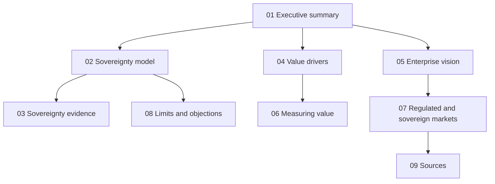

# Value realisation

The written case for Sovra in an enterprise: how sovereign the system is
today, layer by layer and with evidence; what value it creates and how that
value is measured; and where the vision leads, from one computer to a
sovereign organisation. The slide versions are the
[value deck](../decks/value/index.html) and the
[UAE deck](../decks/uae/index.html). This folder is the source those decks
draw on.

## Who should read what

| Reader | Start with | Then |
| --- | --- | --- |
| Investor, non-technical audience | [10 — Investor brief](10-investor-brief.md) | [01 — Executive summary](01-executive-summary.md), [09 — Sources](09-sources.md) |
| Executive or sponsor | [01 — Executive summary](01-executive-summary.md) | [05 — Enterprise vision](05-enterprise-vision.md), [06 — Measuring value](06-measuring-value.md) |
| Security, data protection, CISO | [02 — Sovereignty model](02-sovereignty-model.md) | [03 — Sovereignty evidence](03-sovereignty-evidence.md), [08 — Limits and objections](08-limits-and-objections.md) |
| Chief AI Officer, operations | [04 — Value drivers](04-value-drivers.md) | [06 — Measuring value](06-measuring-value.md), [05 — Enterprise vision](05-enterprise-vision.md) |
| Legal, compliance, public sector | [07 — Regulated and sovereign markets](07-regulated-and-sovereign-markets.md) | [03](03-sovereignty-evidence.md), [09 — Sources](09-sources.md) |
| Sales and partners | [01](01-executive-summary.md) | [08](08-limits-and-objections.md), then everything else |

## The documents

| File | What it answers |
| --- | --- |
| [01-executive-summary.md](01-executive-summary.md) | The problem, Sovra's answer, the vision and the ask, on two pages. |
| [02-sovereignty-model.md](02-sovereignty-model.md) | Seven layers of sovereignty (data, knowledge, model, decisions, learning, operations, jurisdiction): where Sovra stands, with a scorecard. |
| [03-sovereignty-evidence.md](03-sovereignty-evidence.md) | Where every claim is in the code. Includes the full network destination list and a fully local setup. |
| [04-value-drivers.md](04-value-drivers.md) | The value tree: productivity, cost avoided, risk reduced and strategic value, mapped to measures. |
| [05-enterprise-vision.md](05-enterprise-vision.md) | Person → group → company → regulated: what each stage adds to sovereignty and value. |
| [06-measuring-value.md](06-measuring-value.md) | Value hypotheses, baselines, indicators, pilot design, the shared success plan and decision gates. |
| [07-regulated-and-sovereign-markets.md](07-regulated-and-sovereign-markets.md) | What local-first removes and what must still ship; sectors; the UAE in detail. Not legal advice. |
| [08-limits-and-objections.md](08-limits-and-objections.md) | Everything Sovra does not do today, the objection each raises, and the answer. |
| [09-sources.md](09-sources.md) | Every outside fact, with its date. |
| [10-investor-brief.md](10-investor-brief.md) | **Non-technical investor brief**: the UAE's AI-native goal, sovereignty in plain words, value realisation, a 10-minute talk track, investor questions and a glossary. |

## Rules this folder follows

The same rules as [`docs/decks/README.md`](../decks/README.md) and
[`docs/roadmap/README.md`](../roadmap/README.md):

- **Today** describes only what the desktop app does now. Each claim is backed
  by a file in [03](03-sovereignty-evidence.md).
- **Next** is the remaining stage-2 design. Basic [Groups](../groups.md)
  membership and shared text knowledge are implemented; private encrypted lanes,
  helper bundles and work handoff remain planned.
- **Direction** (also written "the direction, not today") is stages 3–4, the
  company fleet and regulated work. These are outlines that will change.
- No invented market size, revenue, return on investment or headcount. Value is
  measured by the customer against their own baseline.
- Every outside figure carries a source and a date. Law summaries are not
  legal advice.
- When code and these documents disagree, the code wins. Fix the document.

Last checked against the code on 2026-11-06.
